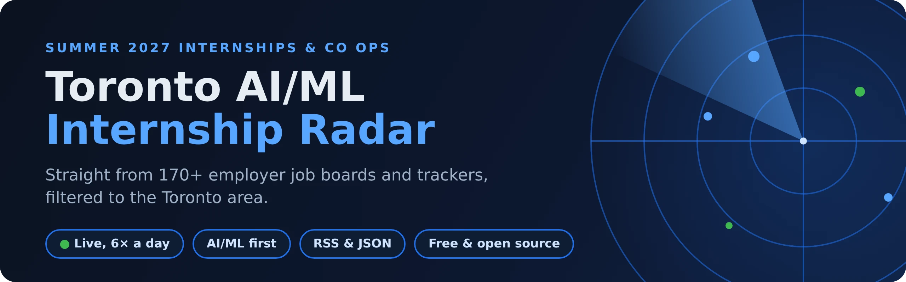

<p align="center">
  
</p>

[](https://github.com/krishi-shah/Toronto-AI-ML-internship-radar/actions/workflows/radar.yml)
[](https://github.com/krishi-shah/Toronto-AI-ML-internship-radar/stargazers)
[](https://github.com/krishi-shah/Toronto-AI-ML-internship-radar/commits/main)
[](#never-check-this-page-again)
[](LICENSE)

**Every Summer 2027 AI/ML internship and co op in and around Toronto, in one
list, refreshed six times a day.**

It reads 170+ sources directly: employer job boards (Workday, Greenhouse,
Lever, Ashby, iCIMS and more), VC portfolio boards and community trackers.
Then it keeps only roles within commuting distance of Toronto and lists each
role once. Free and open source, with no accounts and no paid APIs.

**[See the roles](#the-feed)** &nbsp;·&nbsp;
**[Get new roles automatically](#never-check-this-page-again)** &nbsp;·&nbsp;
[JSON feed](feed.json) &nbsp;·&nbsp;
[Suggest a company](../../issues/new?template=add_company.yml) &nbsp;·&nbsp;
[How it works](HOW_IT_WORKS.md)

## Why this list

- **Straight from the source.** Most roles come from the employer's own job
  board, often hours before they reach the big trackers.
- **Toronto only.** The GTA, Hamilton, Waterloo Region and Guelph, plus remote
  in Canada. Nothing from Vancouver, Montreal or the US.
- **AI/ML first.** The *Strict* list is AI, ML and data science roles,
  including software roles whose job description is mostly AI work. *Loose*
  holds other tech student roles.
- **Fresh and clean.** AI/ML roles from the last 14 days, others from the last
  7, newest first. One row per role, and a role drops out once the employer
  takes it down.
- **Summer 2027 focus.** Summer 2027 roles (including Waterloo's Spring term)
  lead the list. Roles for other terms sit in *Loose*.

## Never check this page again

- **RSS:** an RSS reader app (Feedly, Inoreader, or Slack's RSS app) shows
  new roles as they're posted, like an inbox. Copy this link and add it as a
  new feed in the app:

  ```
  https://raw.githubusercontent.com/krishi-shah/Toronto-AI-ML-internship-radar/main/feed.xml
  ```

  Opening the link in a browser shows raw code; that's normal, it's meant for
  the reader app.
- **JSON:** [`feed.json`](feed.json) has the same roles for your own scripts
  and bots.

**Found it useful?** Star the repo so other students find it, and share it
with your classmates.

---

## The feed

Everything between the markers is generated. Do not hand-edit it.

<!-- radar:listings:start -->

_Updated Tuesday 10 November, 20:31 Toronto &middot; 184/184 sources healthy &middot; AI/ML last 14 days, others last 7 days, newest first._

### Strict &middot; 32 AI/ML matches &middot; last 14 days

| Role | Company | Location | Term | Posted |
|---|---|---|---|---|
| [Information Security Analyst Co-op, Winter](https://jobs.lever.co/magnetforensics/21c3d181-2751-4255-8084-f82cdc799483) <br><sub>AI in description: LLMs, data science, conversational AI, AI features</sub> | Magnet Forensics | Waterloo, Canada, Ottawa, Canada | - | **Today** |
| [ML Research Intern, Reconstruction, Spring](https://jobs.dover.com/peripheral/d05a12b8-ad7b-43b2-b8dc-f58651fa4811) | Peripheral | Toronto, Canada | - | **Today** |
| [Robotics Engineering Intern, Capture Systems, Summer](https://jobs.dover.com/peripheral/6faa193a-8c36-4416-b97b-38602292f157) | Peripheral | Toronto, Canada | - | **Today** |
| [Student Intern, SCM Data Scientist](https://jobright.ai/jobs/info/6adb95bfc5c64fa3d9cb02f6?utm_campaign=1066&utm_source=git) | Celestica | Toronto, ON, Canada | - | Yesterday |
| [Software Design Engineer Intern](https://datarobot.wd1.myworkdayjobs.com/en-US/DataRobot_External_Careers/job/Boston-Massachusetts-US/Software-Design-Engineer-Intern_R-102764) <br><sub>AI in description: LLMs, data science, generative AI, AI agents</sub> | DataRobot | Boston, Massachusetts, US, Seattle, Washington, US, Remote Canada - ON, San Francisco, California, US, United States of America | - | 4 days ago |
| [Quantitative Analyst, Summer 2027 (Co-op/Internship) - 4 Months](https://bmo.wd3.myworkdayjobs.com/en-US/Campus/job/Toronto-ON-CAN/Quantitative-Analyst--Summer-2027--Co-op-Internship----4-Months_R260031097-1) <br><sub>AI in description: machine learning, deep learning, data science</sub> | Bank of Montreal | Toronto, ON, CAN | Summer 2027 | 4 days ago |
| [Forward Deployed Engineer (FDE) Intern (8-12 month intern)](https://elementfleet.wd3.myworkdayjobs.com/en-US/External_Career_Site/job/Toronto/Forward-Deployed-Engineer--FDE--Intern--8-12-month-intern-_R105989) <br><sub>AI in description: machine learning, LLMs, RAG, embeddings, data science, AI agents</sub> | Element Fleet Management | Toronto | - | 5 days ago |
| [AI Solutions Specialist Co-op, Winter](https://rodanenergysolutionsinc.applytojob.com/apply/CrbmvnkugD/AI-Solutions-Specialist-Coop-Student-Winter-2027) | Rodan Energy Solutions Inc. | Mississauga, Canada | - | 5 days ago |
| [Data Operations Engineer AI Co-op, Winter](https://rodanenergysolutionsinc.applytojob.com/apply/baC6tVrSpB/Data-Operations-Engineer-AI-Coop-Student-Winter-2027) | Rodan Energy Solutions Inc. | Mississauga, Canada | - | 5 days ago |
| [Junior Full-Stack Engineer Intern](https://volarisgroup.wd3.myworkdayjobs.com/BiblioCommons/job/Canada---Ontario/PEY---Junior-Fullstack-Engineer_R72454) <br><sub>AI in description: AI agents, LLM APIs</sub> | BiblioCommons | Ontario, Canada | - | 6 days ago |
| [Applied AI Engineer Intern](https://plusgrade.wd10.myworkdayjobs.com/en-US/Plusgrade_External_Site/job/CAN---Toronto/Applied-AI-Engineer-Intern_JR100233) | Plusgrade | CAN - Toronto | - | 6 days ago |
| [Applied AI Test Engineer - Intern](https://plusgrade.wd10.myworkdayjobs.com/en-US/Plusgrade_External_Site/job/CAN---Toronto/Applied-AI-Test-Engineer---Intern_JR100227) | Plusgrade | CAN - Toronto | - | 6 days ago |
| [Data Science Intern](https://plusgrade.wd10.myworkdayjobs.com/en-US/Plusgrade_External_Site/job/CAN---Toronto/Data-Science-Intern_JR100230) | Plusgrade | CAN - Toronto | - | 6 days ago |
| [FY27 Intern - Machine Learning Engineering Internship - Canada (4 months)](https://qualcomm.eightfold.ai/careers/job/446721969461) | Qualcomm | Markham, Ontario, Canada | - | 7 days ago |
| [2027 Capital Markets, Global Equities, AI Engineer (16 Months, Co-op)](https://rbc.wd3.myworkdayjobs.com/en-US/RBCEARLYTALENT1/job/TORONTO-Ontario-Canada/XMLNAME-2027-Capital-Markets--Global-Equities--AI-Engineer--16-Months--Co-op-_R-0000187401-1) | Royal Bank of Canada | TORONTO, Ontario, Canada | - | 7 days ago |
| [AI Governance &amp; Policy Intern](https://tmx.wd3.myworkdayjobs.com/en-US/TMX_Careers/job/Toronto---100-Adelaide-St-W/AI-Governance---Policy-Co-op-Student_R-6648) | TMX Group | Toronto - 100 Adelaide St W | - | 8 days ago |
| [GPU &amp; AI Accelerator Hardware Design Undergraduate Intern](https://intel.wd1.myworkdayjobs.com/en-US/External/job/Canada-Toronto/GPU---AI-Accelerator-Hardware-Design-Undergraduate-Intern_JR0287539) | Intel | Canada, Toronto | - | 8 days ago |
| [Co-op, User Experience - Robotics](https://rockwellautomation.wd1.myworkdayjobs.com/en-US/External-Rockwell-Automation-Early-Careers/job/Waterloo-Ontario-Canada/Co-op--User-Experience---Robotics_R26-8569-2) | Rockwell Automation | Waterloo, Ontario, Canada | - | 8 days ago |
| [FY27 Intern - Deep Learning Research Internship - Canada (4 Months)](https://qualcomm.eightfold.ai/careers/job/446721913898) | Qualcomm | Markham, Ontario, Canada | - | 9 days ago |
| [FY27 Intern - Qualcomm SoC Engineering Internship - Canada (16 months)](https://qualcomm.eightfold.ai/careers/job/446721914045) <br><sub>AI in description: machine learning, deep learning, LLMs, RAG, neural networks, generative AI, ML engineering, AI agents</sub> | Qualcomm | Markham, Ontario, Canada | - | 9 days ago |
| [Campus Undergraduate Summer Internship Program - 2027 AI Engineer, Enterprise Technology Services- Toronto, Ontario, CN](https://egug.fa.us2.oraclecloud.com/hcmUI/CandidateExperience/en/sites/CX_1/job/26016035) | American Express | Toronto, ON, Canada | - | 9 days ago |
| [Software Engineer Co-op, AI, Winter](https://foresters.wd3.myworkdayjobs.com/en-US/ForestersFinancialCareers/job/Toronto-Ontario/Software-Engineer-Co-op-Student--AI---4-month-contract-_R-2332) | Foresters Financial | Toronto, Canada | - | 11 days ago |
| [Full-stack AI Developer Intern](https://revvity.wd103.myworkdayjobs.com/en-US/External/job/CAD-Remote--ON/Full-stack-AI-Developer-Intern_JR-045792) | Revvity | CAD Remote – ON | - | 11 days ago |
| [PhD Research Intern, Quantum and AI for Chemistry - 2027](https://nvidia.wd5.myworkdayjobs.com/en-US/NVIDIAExternalCareerSite/job/Canada-Toronto/PhD-Research-Intern--Quantum-and-AI-for-Chemistry---2027_JR2024997) | Nvidia | Canada, Toronto | - | 11 days ago |
| [PhD Machine Learning Engineer, Intern](https://stripe.com/jobs/search?gh_jid=8328664) | Stripe | Toronto | - | 11 days ago |
| [Master's Machine Learning Engineer, Intern](https://stripe.com/jobs/search?gh_jid=8333122) | Stripe | Toronto | - | 11 days ago |
| [Data Associate (Winter/Spring 2027)](https://lumerate.breezy.hr/p/baf2283496ad-data-associate-winter-spring-2027) <br><sub>AI in description: machine learning, LLMs, data science</sub> | Lumerate | Canada, remote | Spring 2027 | 11 days ago |
| [FY27 Intern - AI Software Engineering Co-op - Canada (4 months)](https://qualcomm.eightfold.ai/careers/job/446721862429) | Qualcomm | Toronto, Ontario, Canada | - | 12 days ago |
| [FY27 Intern - AI Software Systems Co-op - Canada (4 months)](https://qualcomm.eightfold.ai/careers/job/446721862430) | Qualcomm | Toronto, Ontario, Canada | - | 12 days ago |
| [FY27 Intern - Deep Learning Research Internship - Embodied AI - Canada (4 Months)](https://qualcomm.eightfold.ai/careers/job/446721858024) | Qualcomm | Markham, Ontario, Canada | - | 13 days ago |
| [GTM (FAE &amp; Customer Success) and Product Intern](https://job-boards.greenhouse.io/tenstorrentuniversity/jobs/5274249007) | Tenstorrent | Santa Clara, California, United States; Toronto, Ontario, Canada | - | 13 days ago |
| [Intern, AI Value Creation Office](https://brookfield.wd5.myworkdayjobs.com/en-US/brookfieldprivate/job/Toronto-Ontario/Intern--AI-Value-Creation-Office_R2048790) | Brookfield | Toronto, Ontario | - | date unknown |

### Loose &middot; 81 to review

| Role | Company | Location | Term | Posted |
|---|---|---|---|---|
| [Information Security Analyst Co-op (Winter 2027)](https://jobs.lever.co/magnetforensics/21c3d181-2751-4255-8084-f82cdc799483) | Magnet Forensics | Waterloo / Ottawa / Ontario, remote, Co-op | Winter 2027 | **Today** |
| [DevOps Analyst Intern](https://hitachi.wd1.myworkdayjobs.com/en-US/hitachi/job/Toronto-Ontario-Canada/DevOps-Analyst-Intern_R0145523) | Hitachi Energy | Toronto, Ontario, Canada | - | **Today** |
| [Data Analyst, Winter 2027 (Co-o/Internship) - 8 months](https://bmo.wd3.myworkdayjobs.com/en-US/Privileged/job/Toronto-ON-CAN/Data-Analyst--Winter-2027--Co-o-Internship----8-months_R260026973) | Bank of Montreal | Toronto, ON, CAN | Winter 2027 | **Today** |
| [Embedded Systems Engineering Intern, Capture Systems, Spring](https://jobs.dover.com/peripheral/7682c7e9-33ad-4975-8c29-a21e0cb62693) | Peripheral | Toronto, Canada | - | **Today** |
| [Software Engineer Intern, Infrastructure, Spring](https://jobs.dover.com/peripheral/4f4baf30-f659-4172-881e-4497b3808ad0) | Peripheral | Toronto, Canada | - | **Today** |
| [Software Engineer Intern, WW, Summer](https://jobs.dover.com/decoda-health/206b2863-dde9-4f61-9971-c2176c0fc805) | Decoda Health | Toronto, Canada | - | **Today** |
| [IT Business Application Development Intern, Summer](https://careers.celestica.com/job/Toronto-Student-Intern%2C-IT-Business-Application-Development-ON/1455777233) | Celestica | Toronto, Canada | - | Yesterday |
| [Student Intern, Process and Manufacturing Engineer](https://careers.celestica.com/job/Newmarket-Student-Intern%2C-Process-and-Manufacturing-Engineer-ON/1456226233/) | Celestica | Newmarket, ON, CA | - | Yesterday |
| [Student Intern, Automation Support / Development Engineering](https://careers.celestica.com/job/Newmarket-Student-Intern%2C-Automation-Support-Development-Engineering-ON/1456169333/) | Celestica | Newmarket, ON, CA | - | Yesterday |
| [Student Intern, Test Manufacturing and Process Engineering](https://careers.celestica.com/job/Newmarket-Student-Intern%2C-Test-Manufacturing-and-Process-Engineering-ON/1456225233/) | Celestica | Newmarket, ON, CA | - | Yesterday |
| [Software Engineering Intern](https://jobright.ai/jobs/info/6adbb7875dc7953215a34177?utm_campaign=1079&utm_source=git) | Trimble Inc. | Richmond Hill, Ontario, Canada | - | Yesterday |
| [Research Intern](https://jobright.ai/jobs/info/6af37de310c7aed77861aedb?utm_campaign=1066&utm_source=git) | CEM | Toronto, ON, Canada | - | Yesterday |
| [Winter 2027 - Software Development and Artificial Intelligence Intern](https://jobright.ai/jobs/info/6aa83b0782e82a31997c4912?utm_campaign=1079&utm_source=git) | GIRO | Rosemont, Canada | Winter 2027 | Yesterday |
| [Application Software Developer Co-Op](https://onehealthineers.wd3.myworkdayjobs.com/en-US/SHSJB/job/YOW-B/Application-Software-Developer-Co-Op_R-31984) | Varian | YOW B | - | Yesterday |
| [Engineering Co-Op Student](https://magna.wd3.myworkdayjobs.com/en-US/Magna/job/Woodbridge-Ontario-CA/Engineering-Co-Op-Student_R00252065) | Magna | Woodbridge, Ontario, CA | - | Yesterday |
| [Software Developer (New or Recent Graduate)](https://bmo.wd3.myworkdayjobs.com/en-US/External/job/Toronto-ON-CAN/Software-Developer_R260028581) | BMO | Toronto, ON, CAN | - | Yesterday |
| [Associate Graduate Leadership Development Program - Summer 2027](https://cibc.wd3.myworkdayjobs.com/en-US/campus/job/Toronto-ON/Associate-Graduate-Leadership-Development-Program---Summer--2027_2622684) | CIBC | Toronto, ON | Summer 2027 | Yesterday |
| [Associate Technology Leadership Advancement Program - Summer 2027](https://cibc.wd3.myworkdayjobs.com/en-US/campus/job/Toronto-ON/Associate-Technology-Leadership-Advancement-Program---Summer-2027_2623078) | CIBC | Toronto, ON | Summer 2027 | Yesterday |
| [Intern, Stress Testing, Risk Management](https://jobs.lever.co/eqbank/1411252b-9a78-428f-917e-05ba38fa2c26) | Equitable Bank | Toronto, hybrid, Student | - | Yesterday |
| [BI/Data Analyst Intern](https://job-boards.greenhouse.io/kensingtontours/jobs/5289223007) | Kensington | Toronto, ON, Canada | - | Yesterday |
| [Marketing Data &amp; AI Analyst Student (Winter 2027)](https://bb.wd3.myworkdayjobs.com/en-US/Student/job/Waterloo-Ontario/Marketing-Data---AI-Analyst-Student--Winter-2027-_20260327) | Blackberry | Waterloo, Ontario | Winter 2027 | Yesterday |
| [Software Engineer - Intern](https://altera.wd1.myworkdayjobs.com/en-US/altera/job/Toronto-Ontario-Canada/Software-Engineer----Intern_R03414) | Altera | Toronto, Ontario, Canada | - | Yesterday |
| [Student Intern, IT Business Application Development](https://careers.celestica.com/job/Toronto-Student-Intern%2C-IT-Business-Application-Development-ON/1455777233/) | Celestica | Toronto, ON, CA | - | 2 days ago |
| [Associate Technology Leadership Advancement Program Intern, Summer 2027](https://cibc.wd3.myworkdayjobs.com/search/job/Toronto-ON/Associate-Technology-Leadership-Advancement-Program---Summer-2027_2623078-1) | CIBC | Toronto, ON, Canada | Summer 2027 | 2 days ago |
| [Marketing Data &amp; AI Analyst Intern, Winter 2027](https://bb.wd3.myworkdayjobs.com/Student/job/Waterloo-Ontario/Marketing-Data---AI-Analyst-Student--Winter-2027-_20260327) | Blackberry | Waterloo, ON, Canada | Winter 2027 | 2 days ago |
| [Photonics Test Engineer](https://jobs.realventures.com/companies/real-ventures/jobs/99109613-photonics-test-engineer#content) | Real Ventures | Toronto, ON, Canada | - | 3 days ago |
| [Analytics Engineering &amp; Measurement Student](https://olg.wd3.myworkdayjobs.com/en-US/Careers-Students/job/Toronto-Ontario-Canada/Analytics-Engineering---Measurement-Student_R26_00700) | OLG | Toronto, Ontario, Canada, Sault Ste. Marie, Ontario, Canada, Canada | - | 4 days ago |
| [Analytics Engineering &amp; Measurement Intern, Winter](https://olg.wd3.myworkdayjobs.com/Careers-Students/job/Toronto-Ontario-Canada/Analytics-Engineering---Measurement-Student_R26_00700) | OLG | Toronto, Canada, Sault Ste. Marie, Canada | - | 4 days ago |
| [Co-op/Intern, Software Development - Winter 2027](https://job-boards.greenhouse.io/hootsuite/jobs/8360176) | Hootsuite | Vancouver, BC, Toronto, ON | Winter 2027 | 4 days ago |
| [BMO Personal &amp; Business Banking Development Program (New Graduate) - 2 Year Program](https://bmo.wd3.myworkdayjobs.com/en-US/Campus/job/Toronto-ON-CAN/BMO-Personal---Business-Banking-Development-Program--New-Graduate----2-Year-Program_R260031068-1) | Bank of Montreal | Toronto, ON, CAN | - | 4 days ago |
| [Technology Research Associate, Winter 2027 (Co-op/Internship) - 4 months](https://bmo.wd3.myworkdayjobs.com/en-US/Privileged/job/Toronto-ON-CAN/Technology-Research-Associate--Winter-2027--Co-op-Internship----4-months_R260024978) | Bank of Montreal | Toronto, ON, CAN | Winter 2027 | 4 days ago |
| [Student, Associate DevOps Engineer (Winter 2027)](https://sunlife.wd3.myworkdayjobs.com/en-US/Campus/job/Waterloo-Ontario/Student--Associate-DevOps-Engineer--Winter-2027-_JR00127798) | Sun Life | Waterloo, Ontario | Winter 2027 | 4 days ago |
| [Software Engineering Intern - Waterloo University - Winter Session](https://job-boards.greenhouse.io/brave/jobs/8360001) | Brave | Canada | - | 4 days ago |
| [Production Development Engineering Intern (Co-op), Winter 2027](https://jobs.realventures.com/companies/real-ventures/jobs/99001747-production-development-engineering-intern-co-op-winter-2027#content) | Real Ventures | Mississauga, ON, Canada | Winter 2027 | 4 days ago |
| [Graphics Hardware Validation Undergraduate Engineering Intern](https://intel.wd1.myworkdayjobs.com/en-US/External/job/Canada-Toronto/Graphics-Hardware-Validation-Undergraduate-Engineering-Intern_JR0287535) | Intel | Canada, Toronto | - | 5 days ago |
| [FY27 Intern - Digital Design Engineering Intern - Canada (16 months)](https://qualcomm.eightfold.ai/careers/job/446722005254) | Qualcomm | Toronto, Ontario, Canada | - | 5 days ago |
| [Service Router Test Student](https://fa-evmr-saasfaprod1.fa.ocs.oraclecloud.com/hcmUI/CandidateExperience/en/sites/CX_1/job/41069) | Nokia | Canada | - | 5 days ago |
| [Analytics Engineering &amp; Measurement Student Intern, Winter 2027](https://olg.wd3.myworkdayjobs.com/Careers-Students/job/Toronto-Ontario-Canada/Analytics-Engineering---Measurement-Student_R26_00700) | OLG | Toronto, ON, Canada, Sault Ste. Marie, ON, Canada | Winter 2027 | 5 days ago |
| [Product Design Intern](https://stripe.com/jobs/search?gh_jid=8332683) | Stripe | Toronto | - | 5 days ago |
| [Loblaw Brands, Technology Transformation - Co-op Student](https://myview.wd3.myworkdayjobs.com/en-US/paradox_careers/job/1-Presidents-Choice-Circle-Brampton-ON/Loblaw-Brands--Technology-Transformation---Co-op-Student_R2000695051) | Loblaw Companies | 1 Presidents Choice Circle, Brampton, ON | - | 5 days ago |
| [Software Developer Intern (May 2027 12 Months)](https://soti.wd3.myworkdayjobs.com/en-US/SOTI-Next-Gen/job/Mississauga-Canada--Meadowvale-Office-HQ/Software-Developer-Intern--May-2027-12-Months-_R10655) | SOTI | Mississauga, Canada – Meadowvale Office (HQ) | - | 5 days ago |
| [Software Developer Intern - Android (May 2027 - 12 Months)](https://soti.wd3.myworkdayjobs.com/en-US/SOTI-Next-Gen/job/Mississauga-Canada--Meadowvale-Office-HQ/Software-Developer-Intern---Android--May-2027---12-Months-_R10650) | SOTI | Mississauga, Canada – Meadowvale Office (HQ) | - | 5 days ago |
| [Performance Test Engineer Intern (January 2027 - 12 months)](https://soti.wd3.myworkdayjobs.com/en-US/SOTI-Next-Gen/job/Mississauga-Canada--Meadowvale-Office-HQ/Performance-Test-Engineer-Intern--January-2027---12-months-_R10639) | SOTI | Mississauga, Canada – Meadowvale Office (HQ) | - | 5 days ago |
| [Performance Test Engineer Intern (May 2027 12 Months)](https://soti.wd3.myworkdayjobs.com/en-US/SOTI-Next-Gen/job/Mississauga-Canada--Meadowvale-Office-HQ/Performance-Test-Engineer-Intern--May-2027-12-Months-_R10626) | SOTI | Mississauga, Canada – Meadowvale Office (HQ) | - | 5 days ago |
| [IT Co-op Student](https://magna.wd3.myworkdayjobs.com/en-US/Magna/job/Brampton-Ontario-CA/IT-Co-op-Student_R00268028-1) | Magna | Brampton, Ontario, CA | - | 5 days ago |
| [QA Tester Intern, Datalogger Products, Fall](https://recruiting.paylocity.com/Recruiting/Jobs/Details/4639800) | AEM | Victoria, Canada | - | 5 days ago |
| [Software Engineer Intern, Summer](https://job-boards.greenhouse.io/doordashcanada/jobs/8170944) | DoorDash | Toronto, Canada | - | 5 days ago |
| [Platform Engineer Intern (8 month term)](https://nelnet.wd1.myworkdayjobs.com/en-US/MyNelnet/job/CAN---MISSISSAUGA/Platform-Engineer-Intern--8-month-term-_R23266) | Nelnet | CAN - MISSISSAUGA | - | 5 days ago |
| [Summer 2027 Intern, Software Engineering](https://ryan.wd1.myworkdayjobs.com/en-US/RyanCareers/job/North-York/Summer-2027-Intern--Software-Engineering_R0020807-1) | Ryan | North York ON | Summer 2027 | 5 days ago |
| [Robotics Software Co-op, Winter](https://ats.rippling.com/4ag/jobs/71d97d10-87f2-4f53-88b7-97f27f392d24) | 4AG Robotics | Salmon Arm, Canada | - | 5 days ago |
| [Web Software Developer Intern, WFM, Summer](https://genesys.wd1.myworkdayjobs.com/2_genesys_jobs/job/Toronto-Flexible/Web-Software-Developer-Intern--WFM-_JR112214-3) | Genesys | Toronto, Canada | - | 5 days ago |
| [Software Engineer Intern, Winter 2027](https://apply.workable.com/datavisor-jobs/j/2FB6A93BF6/apply) | DataVisor | Remote in Canada | Winter 2027 | 6 days ago |
| [Software Engineer Intern, Winter](https://apply.workable.com/datavisor-jobs/j/2FB6A93BF6) | DataVisor | Remote, Canada | - | 6 days ago |
| [Quality Engineering Intern](https://semtech.wd1.myworkdayjobs.com/en-US/SemtechCareers/job/CAN---Burlington-ON/Quality-Engineering-Intern_REQ3692) | Semtech | CAN - Burlington, ON | - | 6 days ago |
| [Student, Analytics &amp; Technology Systems (Winter 2027)](https://sunlife.wd3.myworkdayjobs.com/en-US/Campus/job/Sun-Life-Toronto-One-York/Student--Analytics---Technology-Systems--Winter-2027-_JR00126478) | Sun Life | Sun Life Toronto One York | Winter 2027 | 6 days ago |
| [Student Intern, HealthTech - Product Data Management and Material Pricing](https://careers.celestica.com/job/Toronto-Student-Intern%2C-HealthTech-Product-Data-Management-and-Material-Pricing-ON/1454920933/) | Celestica | Toronto, ON, CA | - | 6 days ago |
| [Full Stack Developer - Entry Level](https://jobs.scotiabank.com/job/Toronto-Full-Stack-Developer-Entry-Level-ON-M5H-1A1/607787817/) | Scotiabank | Toronto, ON, CA, M5H 1A1 | - | 6 days ago |
| [Junior Full-Stack Engineer Intern, Summer](https://volarisgroup.wd3.myworkdayjobs.com/BiblioCommons/job/Canada---Ontario/PEY---Junior-Fullstack-Engineer_R72454) | BiblioCommons | Canada | - | 6 days ago |
| [Intern - Product Management, Winter 2027](https://jobs.lever.co/eqbank/e4ed38f2-5de1-405f-a02d-c21f421bc7c1) | Equitable Bank | Toronto, hybrid, Student | Winter 2027 | 6 days ago |
| [Data Operations Engineer AI - Co-op Student (Winter 2027)](https://rodanenergysolutionsinc.applytojob.com/apply/baC6tVrSpB/Data-Operations-Engineer-AI-Coop-Student-Winter-2027) | Rodan Energy Solutions | Mississauga, ON, Canada | Winter 2027 | found 6 days ago |
| [Jr. Security Analyst Student Intern](https://tmx.wd3.myworkdayjobs.com/en-US/TMX_Careers/job/Toronto---100-Adelaide-St-W/Jr-Security-Analyst-Student-Intern_R-6644) | TMX Group | Toronto - 100 Adelaide St W | - | 6 days ago |
| [Security Engineering Intern](https://tmx.wd3.myworkdayjobs.com/en-US/TMX_Careers/job/Toronto---100-Adelaide-St-W/Security-Engineering-Intern_R-6656) | TMX Group | Toronto - 100 Adelaide St W | - | 6 days ago |
| [Junior Cybersecurity Operations Analyst Intern](https://tmx.wd3.myworkdayjobs.com/en-US/TMX_Careers/job/Toronto---100-Adelaide-St-W/Junior-Cybersecurity-Operations-Analyst-Intern_R-6671) | TMX Group | Toronto - 100 Adelaide St W | - | 6 days ago |
| [Digital Operation Intern](https://mlse.wd3.myworkdayjobs.com/en-US/MLSE/job/Toronto-Ontario/Digital-Operation-Intern_JR0000831-2) | Maple Leaf Sports &amp; Entertainment Partnership (MLSE) | Toronto, Ontario | - | 6 days ago |
| [New Graduate, Geotechnical Engineering](https://slihrms.wd3.myworkdayjobs.com/en-US/careers/job/CAONToronto191-The-West-Mall/New-Graduate--Hydropower---Geotechnical_R-162455) | AtkinsRéalis | CA.ON.Toronto.191 The West Mall, CA.ON.Ottawa.1145 Hunt Club Road, CA.BC.Vancouver. 733 Seymour St., CA.NL.St. John's.1-165 Duckworth St, Canada | - | 6 days ago |
| [Co-op or Intern, Technology - BizApps (January 2027)](https://bdo.wd3.myworkdayjobs.com/en-US/BDO/job/Toronto---Bay-St/Co-op-or-Intern--Technology---BizApps--January-2027-_JR7062) | BDO Canada | Toronto - Bay St, Oakville, Canada | - | 6 days ago |
| [Photonics Test Engineer](https://xanadu.careers.hibob.com/jobs/fa179125-845b-4a10-a648-75c1cc20bda4) | Xanadu | Toronto, ON, Canada | - | 6 days ago |
| [Student Cyber Security Analyst Intern, Winter](https://recruiting.ultipro.ca/MAC5000MCDW/JobBoard/7667adcc-47ae-477a-9183-0d8ef8bc0748/OpportunityDetail?opportunityId=6e6b20f0-d908-4f9e-9edb-f3ac82d1ab64) | MDA | Brampton, Canada | - | 6 days ago |
| [Test Engineering, Co-op](https://armstrongfluidtechnology.bamboohr.com/careers/1001) | Armstrong Fluid Technology | Toronto, Ontario | - | date unknown |
| [Test &amp; Integration Technician Co-op](https://jobs.l3harris.com/job/Waterdown-Test-&-Integration-Technician-Co-op-ON-L9H-0C5/1426011400/) | L3Harris Technologies | Waterdown, ON, CA, L9H 0C5 | - | date unknown |
| [Electro-Optical Engineering Co-Op (Waterdown, CAN)](https://jobs.l3harris.com/job/Waterdown-Electro-Optical-Engineering-Co-Op-%28Waterdown%2C-CAN%29-ON-L9H-0C5/1428469000/) | L3Harris Technologies | Waterdown, ON, CA, L9H 0C5 | - | date unknown |
| [Specialty Engineering Co-Op Waterdown, CAN)](https://jobs.l3harris.com/job/Waterdown-Specialty-Engineering-Co-Op-Waterdown%2C-CAN%29-ON-L9H-0C5/1428469500/) | L3Harris Technologies | Waterdown, ON, CA, L9H 0C5 | - | date unknown |
| [Quality Systems Co-op (Waterdown, CAN)](https://jobs.l3harris.com/job/Waterdown-Quality-Systems-Co-op-%28Waterdown%2C-CAN%29-ON-L9H-0C5/1428471600/) | L3Harris Technologies | Waterdown, ON, CA, L9H 0C5 | - | date unknown |
| [Manufacturing Engineering Intern - Service Co-op](https://jobs.l3harris.com/job/Waterdown-Manufacturing-Engineering-Intern-Service-Co-op-ON-L9H-0C5/1430126700/) | L3Harris Technologies | Waterdown, ON, CA, L9H 0C5 | - | date unknown |
| [FPGA Software Tool Developer Co-Op (Waterdown, CAN)](https://jobs.l3harris.com/job/Waterdown-FPGA-Software-Tool-Developer-Co-Op-%28Waterdown%2C-CAN%29-ON-L9H-0C5/1430127100/) | L3Harris Technologies | Waterdown, ON, CA, L9H 0C5 | - | date unknown |
| [Manufacturing Engineer Co-Op (Waterdown, CAN)](https://jobs.l3harris.com/job/Waterdown-Manufacturing-Engineer-Co-Op-%28Waterdown%2C-CAN%29-ON-L9H-0C5/1430143700/) | L3Harris Technologies | Waterdown, ON, CA, L9H 0C5 | - | date unknown |
| [Project Engineering Co-Op (Waterdown, CAN)](https://jobs.l3harris.com/job/Waterdown-Project-Engineering-Co-Op-%28Waterdown%2C-CAN%29-ON-L9H-0C5/1432399900/) | L3Harris Technologies | Waterdown, ON, CA, L9H 0C5 | - | date unknown |
| [Systems Engineering (R&amp;A) Co-Op (Waterdown, CAN)](https://jobs.l3harris.com/job/Waterdown-Systems-Engineering-%28R&A%29-Co-Op-%28Waterdown%2C-CAN%29-ON-L9H-0C5/1435257600/) | L3Harris Technologies | Waterdown, ON, CA, L9H 0C5 | - | date unknown |
| [Manufacturing Engineering Co-op (Waterdown, CAN)](https://jobs.l3harris.com/job/Waterdown-Manufacturing-Engineering-Co-op-%28Waterdown%2C-CAN%29-ON-L9H-0C5/1441480800/) | L3Harris Technologies | Waterdown, ON, CA, L9H 0C5 | - | date unknown |
| [Intern, Business Development (Winter 2027)](https://pictonmahoney.bamboohr.com/careers/385) | Picton Mahoney Asset Management | Toronto, Ontario | Winter 2027 | date unknown |
| [Intern, Data Engineer (8 Months)](https://pictonmahoney.bamboohr.com/careers/387) | Picton Mahoney Asset Management | Toronto, Ontario | - | date unknown |

<details><summary>Other fields &middot; 85 outside AI/ML</summary>

| Role | Company | Location | Term | Posted |
|---|---|---|---|---|
| [TDI Associate - Rotational Associate Program](https://td.wd3.myworkdayjobs.com/en-US/TD_Bank_Careers/job/Toronto-Ontario/TDI-Associate---Rotational-Associate-Program_R_1505155) | TD | Toronto, Ontario, Montréal, Québec, Saint John, New Brunswick, Halifax, Nova Scotia, Calgary, Alberta, Canada | - | **Today** |
| [Winter Co-op 2027 – Accounting Analyst](https://manulife.wd3.myworkdayjobs.com/en-US/MFCJH_Jobs/job/Toronto-Ontario/Winter-Co-op-2027---Accounting-Analyst_JR26090172) | Manulife Financial | Toronto, Ontario | - | **Today** |
| [Summer Intern 2027 - Transformation Delivery](https://manulife.wd3.myworkdayjobs.com/en-US/MFCJH_Jobs/job/Toronto-Ontario/Summer-Intern-2027---Transformation-Delivery_JR26091895) | Manulife Financial | Toronto, Ontario | - | **Today** |
| [Summer Intern 2027 - Canada Retail Marketing](https://manulife.wd3.myworkdayjobs.com/en-US/MFCJH_Jobs/job/Toronto-Ontario/Summer-Intern-2027---Canada-Retail-Marketing_JR26091051) | Manulife Financial | Toronto, Ontario | - | **Today** |
| [Summer Intern 2027 - Enterprise Strategy](https://manulife.wd3.myworkdayjobs.com/en-US/MFCJH_Jobs/job/Toronto-Ontario/Summer-Intern-2027---Enterprise-Strategy_JR26091796) | Manulife Financial | Toronto, Ontario | - | **Today** |
| [Summer Intern 2027 - Strategy Analyst](https://manulife.wd3.myworkdayjobs.com/en-US/MFCJH_Jobs/job/Toronto-Ontario/Summer-Intern-2027---Strategy-Analyst_JR26100105) | Manulife Financial | Toronto, Ontario | - | **Today** |
| [Summer Intern 2027 - Accounting](https://manulife.wd3.myworkdayjobs.com/en-US/MFCJH_adminJobs/job/Toronto-Ontario/Summer-Intern-2027---Accounting_JR26080118-1) | Manulife Financial | Toronto, Ontario | - | **Today** |
| [Distribution Intern, GAM, Winter 2027 (Co-op/Internship) - 4 months](https://bmo.wd3.myworkdayjobs.com/en-US/Privileged/job/Toronto-ON-CAN/Distribution-Intern--GAM--Winter-2027--Co-op-Internship----4-months_R260031338) | Bank of Montreal | Toronto, ON, CAN | Winter 2027 | **Today** |
| [Treasury &amp; Payment Solutions Strategy Internship, Summer 2027 (4 months)](https://bmo.wd3.myworkdayjobs.com/en-US/External/job/Toronto-ON-CAN/Treasury---Payment-Solutions-Strategy-Internship--Summer-2027--4-months-_R260031382) | BMO | Toronto, ON, CAN | Summer 2027 | **Today** |
| [Summer Intern 2027 - Digital Marketing](https://manulife.wd3.myworkdayjobs.com/en-US/MFCJH_Jobs/job/Toronto-Ontario/Summer-Intern-2027---Digital-Marketing_JR26100419) | Manulife Financial | Toronto, Ontario | - | **Today** |
| [Winter Co-op 2027 – General Account Investments Business Architecture](https://manulife.wd3.myworkdayjobs.com/en-US/MFCJH_Jobs/job/Toronto-Ontario/Winter-Co-op-2027---General-Account-Investments-Business-Architecture_JR26110293) | Manulife Financial | Toronto, Ontario | - | **Today** |
| [Summer Intern 2027 – General Account Investments Business Architecture](https://manulife.wd3.myworkdayjobs.com/en-US/MFCJH_Jobs/job/Toronto-Ontario/Summer-Intern-2027---General-Account-Investments-Business-Architecture_JR26110296) | Manulife Financial | Toronto, Ontario | - | **Today** |
| [Student - FRM Consultant Operation Change &amp; Execution](https://sunlife.wd3.myworkdayjobs.com/en-US/Campus/job/Sun-Life-Waterloo-King/Student---FRM-Consultant-Operation-Change---Execution--6-month-_JR00128573) | Sun Life | Sun Life Waterloo King, Sun Life Toronto One York, Canada | - | **Today** |
| [Student, Junior Financial Analyst (Winter 2027)](https://sunlife.wd3.myworkdayjobs.com/en-US/Campus/job/Toronto-Ontario/Student--Junior-Financial-Analyst--Winter-2027-_JR00129543) | Sun Life | Toronto, Ontario | Winter 2027 | **Today** |
| [Automotive Apprentice Technician Level 2-3 (Evening Shift)](https://jobs.realventures.com/companies/real-ventures/jobs/99365717-automotive-apprentice-technician-level-2-3-evening-shift#content) | Real Ventures | Mississauga, ON, Canada | - | **Today** |
| [Xanadu Residency Program](https://jobs.realventures.com/companies/real-ventures/jobs/99365915-xanadu-residency-program#content) | Real Ventures | Toronto, ON, Canada | - | **Today** |
| [Apprentice Automotive Service Technician Level 2-3](https://jobs.realventures.com/companies/real-ventures/jobs/99366574-apprentice-automotive-service-technician-level-2-3#content) | Real Ventures | Mississauga, ON, Canada | - | **Today** |
| [Apprentice Automotive Service Technician](https://jobs.realventures.com/companies/real-ventures/jobs/99366655-apprentice-automotive-service-technician#content) | Real Ventures | Etobicoke, Toronto, ON, Canada | - | **Today** |
| [Pathways Operations Manager Intern – Summer 2027 (Canada-Wide Opportunities)](https://www.amazon.jobs/en/jobs/10601090/pathways-operations-manager-intern-summer-2027-canada-wide-opportunities) | Amazon | Toronto, Ontario, CAN, CA, ON, Toronto | Summer 2027 | Yesterday |
| [Student Intern, Human Resources](https://careers.celestica.com/job/Toronto-Student-Intern%2C-Human-Resources-ON/1456196333/) | Celestica | Toronto, ON, CA | - | Yesterday |
| [Dealer Support Coordinator Student (4 months) - Winter 2027](https://canadiantirecorporation.wd3.myworkdayjobs.com/en-US/Enterprise_External_Careers_Site/job/Mobile-Location-Ontario-F009/Dealer-Support-Coordinator-Student--4-months----Winter-2027_JR167669) | Canadian Tire | Mobile Location Ontario \[F009\] | Winter 2027 | Yesterday |
| [Enterprise Compliance Intern](https://tmx.wd3.myworkdayjobs.com/en-US/TMX_Careers/job/Toronto---100-Adelaide-St-W/Enterprise-Compliance-Intern_R-6683) | TMX Group | Toronto - 100 Adelaide St W | - | Yesterday |
| [Summer Intern 2027 - Accounting Analyst](https://manulife.wd3.myworkdayjobs.com/en-US/MFCJH_adminJobs/job/Toronto-Ontario/Summer-Intern-2027---Accounting-Analyst_JR26090173) | Manulife Financial | Toronto, Ontario | - | Yesterday |
| [Private Wealth Administrative Assistant - Vaughan, Winter 2027 (Co-op/Internship) - 4 months](https://bmo.wd3.myworkdayjobs.com/en-US/Privileged/job/Vaughan-ON-CAN/Private-Wealth-Administrative-Assistant---Vaughan--Winter-2027--Co-op-Internship----4-months_R260026141) | Bank of Montreal | Vaughan, ON, CAN | Winter 2027 | Yesterday |
| [Private Wealth Analyst, Winter 2027 (Co-op/Internship) - 4 months](https://bmo.wd3.myworkdayjobs.com/en-US/Privileged/job/Toronto-ON-CAN/Private-Wealth-Analyst--Winter-2027--Co-op-Internship----4-months_R260031280) | Bank of Montreal | Toronto, ON, CAN | Winter 2027 | Yesterday |
| [FPGA Design Verification Intern](https://altera.wd1.myworkdayjobs.com/en-US/altera/job/Toronto-Ontario-Canada/FPGA-Design-Verification-Intern_R03440) | Altera | Toronto, Ontario, Canada | - | Yesterday |
| [Business Banking Relationship Manager Trainee](https://bmo.wd3.myworkdayjobs.com/en-US/External/job/Burlington-ON-CAN/Business-Banking-Relationship-Manager-Trainee_R260030894) | BMO | Burlington, ON, CAN | - | Yesterday |
| [Winter Co-op 2027 - Wealth Investment Office Intern](https://manulife.wd3.myworkdayjobs.com/en-US/MFCJH_Jobs/job/Toronto-Ontario/Winter-Co-op-2027---Wealth-Investment-Office-Intern_JR26101278) | Manulife Financial | Toronto, Ontario | - | Yesterday |
| [Financial Governance, Audit &amp; Internal Controls Analyst, Winter 2027 (Co-op/Internship) - 4 Months](https://bmo.wd3.myworkdayjobs.com/en-US/External/job/Toronto-ON-CAN/Financial-Governance-and-Controls-Analyst--Winter-2027--Co-op-Internship----4-Months_R260024742-1) | BMO | Toronto, ON, CAN | Winter 2027 | Yesterday |
| [Intern - Marketing (Web)](https://job-boards.greenhouse.io/kensingtontours/jobs/5270152007) | Kensington | Toronto, ON, Canada | - | Yesterday |
| [FY27 Intern - Firmware Engineering Internship - Canada (16 months)](https://qualcomm.eightfold.ai/careers/job/446722038614) | Qualcomm | Toronto, Ontario, Canada | - | 2 days ago |
| [Campus Undergraduate Summer Internship Program - 2027 Finance, Finance - Toronto, Ontario, CN](https://egug.fa.us2.oraclecloud.com/hcmUI/CandidateExperience/en/sites/CX_1/job/26016023) | American Express | Toronto, ON, Canada | - | 2 days ago |
| [Geomatics Co-op Student - Summer 2027](https://hdhl.fa.us6.oraclecloud.com/hcmUI/CandidateExperience/en/sites/CX_1/job/1008786) | Stantec | Ottawa, ON, Canada, Waterloo, ON, Canada, Markham, ON, Canada | Summer 2027 | 2 days ago |
| [GE Vernova Nuclear Canadian Licensing Intern - 12 Co-op](https://gevernova.wd5.myworkdayjobs.com/en-US/only_confidential_executive_recruiting/job/Markham/GE-Vernova-Nuclear-Canadian-Licensing-Intern---12-Co-op_R5054215-1) | GE Vernova | Markham | - | 4 days ago |
| [Market Risk Associate Rotational Program](https://td.wd3.myworkdayjobs.com/en-US/TD_Bank_Careers/job/Toronto-Ontario/Market-Risk-Associate_R_1503780-1) | TD | Toronto, Ontario | - | 4 days ago |
| [Financial Advisor Intern](https://rbc.wd3.myworkdayjobs.com/en-US/rbcglobal1/job/HAMILTON-Ontario-Canada/Financial-Advisor_R-0000184478) | Royal Bank of Canada | HAMILTON, Ontario, Canada | - | 4 days ago |
| [Student, Telephony Analyst, Co-op (Winter and Summer 2027)](https://sunlife.wd3.myworkdayjobs.com/en-US/Campus/job/Toronto-Ontario/Student--Telephony-Analyst--Co-op--Winter-and-Summer-2027-_JR00129532) | Sun Life | Toronto, Ontario | Summer 2027 | 4 days ago |
| [Personal Banking Associate Trainee Future Opportunities (Richmond Hill, Newmarket, Aurora, North York and Vaughan)](https://td.wd3.myworkdayjobs.com/en-US/TD_Bank_Careers/job/Newmarket-Ontario/Personal-Banking-Associate-Trainee-Future-Opportunities--Richmond-Hill--Newmarket--Aurora--North-York-and-Vaughan-_R_1497915) | TD | Newmarket, Ontario, Richmond Hill, Ontario, Aurora, Ontario, Canada | - | 5 days ago |
| [FY27 Intern - RF/Analog Verification Engineering Internship - Canada (4 or 16 months)](https://qualcomm.eightfold.ai/careers/job/446722001120) | Qualcomm | Markham, Ontario, Canada | - | 5 days ago |
| [FY27 Intern - Software Validation Engineering Internship - Canada (16 months)](https://qualcomm.eightfold.ai/careers/job/446722003454) | Qualcomm | Markham, Ontario, Canada | - | 5 days ago |
| [Digital Marketing - Winter 2027 Co-op/Intern](https://hdks.fa.ca2.oraclecloud.com/hcmUI/CandidateExperience/en/sites/CX_1/job/9480) | Definity Financial | Toronto, ONT, Canada, Waterloo, ONT, Canada | Winter 2027 | 5 days ago |
| [Personal &amp; Business Banking New Grad](https://bmo.wd3.myworkdayjobs.com/External/job/Toronto-ON-CAN/BMO-Personal---Business-Banking-Development-Program--New-Graduate----2-Year-Program_R260031068) | Bank of Montreal | Toronto, ON, Canada | - | 5 days ago |
| [Talent Acquisition Intern (8 months)](https://jobs.ashbyhq.com/super.com/4e876585-970b-41ee-8980-6ab6ced0ef44) | Super.com | Toronto | - | 5 days ago |
| [Quality Assurance Specialist Intern - Android (May 2027 - 12 Months)](https://soti.wd3.myworkdayjobs.com/en-US/SOTI-Next-Gen/job/Mississauga-Canada--Meadowvale-Office-HQ/Quality-Assurance-Specialist-Intern---Android--May-2027---12-Months-_R10651) | SOTI | Mississauga, Canada – Meadowvale Office (HQ) | - | 5 days ago |
| [Associate, Strategy Analyst - New Grad 2027](https://capitalone.wd12.myworkdayjobs.com/en-US/Capital_One/job/Toronto-ON/Associate--Strategy-Analyst---New-Grad-2027_R242577-1) | Capital One | Toronto, ON | - | 5 days ago |
| [Intern, Strategy Analyst - Summer 2027](https://capitalone.wd12.myworkdayjobs.com/en-US/Capital_One/job/Toronto-ON/Intern--Strategy-Analyst---Summer-2027_R243855-1) | Capital One | Toronto, ON | Summer 2027 | 5 days ago |
| [Financial Planning Delivery Excellence Intern/Co-Op (Winter 2027)](https://td.wd3.myworkdayjobs.com/en-US/TD_Bank_Careers/job/Toronto-Ontario/Financial-Planning-Delivery-Excellence-Intern-Co-Op--Winter-2027-_R_1503307) | TD | Toronto, Ontario | Winter 2027 | 5 days ago |
| [Direct Investing Acquisition Strategy Intern / Co-Op (Winter 2027)](https://td.wd3.myworkdayjobs.com/en-US/TD_Bank_Careers/job/Toronto-Ontario/Direct-Investing-Acquisition-Strategy-Intern---Co-Op--Winter-2027-_R_1507390) | TD | Toronto, Ontario | Winter 2027 | 5 days ago |
| [Personal Banker Trainee](https://td.wd3.myworkdayjobs.com/en-US/TD_Bank_Careers/job/Orangeville-Ontario/Personal-Banker-Trainee_R_1517239-1) | TD | Orangeville, Ontario | - | 5 days ago |
| [Co-op Student - Construction (Winter 2027)](https://slihrms.wd3.myworkdayjobs.com/en-US/careers/job/CAONToronto415-Eastern-Ave/Co-op-Student---Construction--Winter-2027-_R-165126) | AtkinsRéalis | CA.ON.Toronto.415 Eastern Ave | Winter 2027 | 6 days ago |
| [Display IP FPGA Emulation Intern, Summer](https://careers.qualcomm.com/careers/job/446721972361) | Qualcomm | Markham, Canada | - | 6 days ago |
| [FY27 Intern - Telemetry Firmware, Driver and Tools Developer Internship - Canada (16 months)](https://qualcomm.eightfold.ai/careers/job/446721989047) | Qualcomm | Markham, Ontario, Canada | - | 6 days ago |
| [Student Intern, Commodity Management Associate](https://careers.celestica.com/job/Toronto-Student-Intern%2C-Commodity-Management-Associate-ON/1454884433/) | Celestica | Toronto, ON, CA | - | 6 days ago |
| [Student Intern, Supply Chain Management \| Strategic Sourcing \| Value Creation](https://careers.celestica.com/job/Toronto-Student-Intern%2C-Supply-Chain-Management-Strategic-Sourcing-Value-Creation-ON/1454907033/) | Celestica | Toronto, ON, CA | - | 6 days ago |
| [Articling Student](https://www.careers.zurich.com/job/Toronto-Articling-Student-ON/1376833957/) | Zurich Insurance | Toronto, ON, CA | - | 6 days ago |
| [Compliance/DSD Conversion Analyst - Co-op Student](https://myview.wd3.myworkdayjobs.com/en-US/paradox_careers/job/1-Presidents-Choice-Circle-Brampton-ON/Compliance-DSD-Conversion-Analyst---Co-op-Student_R2000729357) | Loblaw Companies | 1 Presidents Choice Circle, Brampton, ON | - | 6 days ago |
| [Life Underwriting Trainee](https://manulife.wd3.myworkdayjobs.com/en-US/MFCJH_Jobs/job/Canada-Full-Time-Remote/Life-Underwriting-Trainee_JR26101302-1) | Manulife Financial | Canada, Full Time Remote | - | 6 days ago |
| [Banking Advisor Intern](https://rbc.wd3.myworkdayjobs.com/en-US/rbcglobal1/job/OAKVILLE-Ontario-Canada/Banking-Advisor-Intern_R-0000191860) | Royal Bank of Canada | OAKVILLE, Ontario, Canada | - | 6 days ago |
| [Audio Visual Support Intern](https://tmx.wd3.myworkdayjobs.com/en-US/TMX_Careers/job/Toronto---100-Adelaide-St-W/Audio-Visual-Support-Intern_R-6653) | TMX Group | Toronto - 100 Adelaide St W | - | 7 days ago |
| [Replenishment Optimization, Process Support - Co-op Student](https://myview.wd3.myworkdayjobs.com/en-US/paradox_careers/job/1-Presidents-Choice-Circle-Brampton-ON/Replenishment-Optimization--Process-Support---Co-op-Student_R2000697046) | Loblaw Companies | 1 Presidents Choice Circle, Brampton, ON | - | 7 days ago |
| [Personal Banking Associate Trainee](https://td.wd3.myworkdayjobs.com/en-US/TD_Bank_Careers/job/New-Liskeard-Ontario/Personal-Banking-Associate-Trainee_R_1508659) | TD | New Liskeard, Ontario | - | 7 days ago |
| [Business Analyst Co-op (Winter 2027)](https://cibc.wd3.myworkdayjobs.com/en-US/campus/job/Toronto-ON/Business-Analyst-Co-op--Winter-2027-_2622741) | CIBC | Toronto, ON | Winter 2027 | 7 days ago |
| [Electrical Engineering Co-Op (Waterdown, CAN)](https://jobs.l3harris.com/job/Waterdown-Electrical-Engineering-Co-Op-%28Waterdown%2C-CAN%29-ON-L9H-0C5/1428467500/) | L3Harris Technologies | Waterdown, ON, CA, L9H 0C5 | - | date unknown |
| [Inventory Analyst Co-Op (Waterdown, CAN)](https://jobs.l3harris.com/job/Waterdown-Inventory-Analyst-Co-Op-%28Waterdown%2C-CAN%29-ON-L9H-0C5/1428470000/) | L3Harris Technologies | Waterdown, ON, CA, L9H 0C5 | - | date unknown |
| [Logistics Co-op](https://jobs.l3harris.com/job/Waterdown-Logistics-Co-op-ON-L9H-0C5/1428471300/) | L3Harris Technologies | Waterdown, ON, CA, L9H 0C5 | - | date unknown |
| [Production Planning Co-Op (Waterdown, CAN)](https://jobs.l3harris.com/job/Waterdown-Production-Planning-Co-Op-%28Waterdown%2C-CAN%29-ON-L9H-0C5/1428472400/) | L3Harris Technologies | Waterdown, ON, CA, L9H 0C5 | - | date unknown |
| [Supply Chain Co-op (Waterdown, CAN)](https://jobs.l3harris.com/job/Waterdown-Supply-Chain-Co-op-%28Waterdown%2C-CAN%29-ON-L9H-0C5/1428472700/) | L3Harris Technologies | Waterdown, ON, CA, L9H 0C5 | - | date unknown |
| [Intern, Environmental Health &amp; Safety (Waterdown, CAN)](https://jobs.l3harris.com/job/Waterdown-Intern%2C-Environmental-Health-&-Safety-%28Waterdown%2C-CAN%29-ON-L9H-0C5/1430125700/) | L3Harris Technologies | Waterdown, ON, CA, L9H 0C5 | - | date unknown |
| [FPGA Designer Coop (Waterdown, CAN)](https://jobs.l3harris.com/job/Waterdown-FPGA-Designer-Coop-%28Waterdown%2C-CAN%29-ON-L9H-0C5/1430127300/) | L3Harris Technologies | Waterdown, ON, CA, L9H 0C5 | - | date unknown |
| [Opto-Mechanical Design Co-Op (Waterdown, CAN)](https://jobs.l3harris.com/job/Toronto-Opto-Mechanical-Design-Co-Op-%28Waterdown%2C-CAN%29-ON-M3C-2H2/1430128300/) | L3Harris Technologies | Toronto, ON, CA, M3C 2H2 | - | date unknown |
| [Sales Operations Support Co-Op (Waterdown, CAN)](https://jobs.l3harris.com/job/Waterdown-Sales-Operations-Support-Co-Op-%28Waterdown%2C-CAN%29-ON-L9H-0C5/1430141100/) | L3Harris Technologies | Waterdown, ON, CA, L9H 0C5 | - | date unknown |
| [Manufacturing Engineering - Mechanical Co-Op](https://jobs.l3harris.com/job/Waterdown-Manufacturing-Engineering-Mechanical-Co-Op-ON-L9H-0C5/1430875900/) | L3Harris Technologies | Waterdown, ON, CA, L9H 0C5 | - | date unknown |
| [Materials Co-Op (Waterdown, CAN)](https://jobs.l3harris.com/job/Waterdown-Materials-Co-Op-%28Waterdown%2C-CAN%29-ON-L9H-0C5/1435256200/) | L3Harris Technologies | Waterdown, ON, CA, L9H 0C5 | - | date unknown |
| [Operations Test Engineering, Mechanical Tooling Co-Op (Waterdown, CAN)](https://jobs.l3harris.com/job/Waterdown-Operations-Test-Engineering%2C-Mechanical-Tooling-Co-Op-%28Waterdown%2C-CAN%29-ON-L9H-0C5/1435257000/) | L3Harris Technologies | Waterdown, ON, CA, L9H 0C5 | - | date unknown |
| [Linux Administrator Co-op (Waterdown, CAN)](https://jobs.l3harris.com/job/Waterdown-Linux-Administrator-Co-op-%28Waterdown%2C-CAN%29-ON-L9H-0C5/1435258800/) | L3Harris Technologies | Waterdown, ON, CA, L9H 0C5 | - | date unknown |
| [Procurement Co-op (Waterdown, CAN)](https://jobs.l3harris.com/job/Waterdown-Procurement-Co-op-%28Waterdown%2C-CAN%29-ON-L9H-0C5/1441481400/) | L3Harris Technologies | Waterdown, ON, CA, L9H 0C5 | - | date unknown |
| [Materials - Receiving Co-op (Waterdown, CAN)](https://jobs.l3harris.com/job/Waterdown-Materials-Receiving-Co-op-%28Waterdown%2C-CAN%29-ON-L9H-0C5/1441484600/) | L3Harris Technologies | Waterdown, ON, CA, L9H 0C5 | - | date unknown |
| [Accounts Payable &amp; Tax Co-Op (Waterdown, CAN)](https://jobs.l3harris.com/job/Waterdown-Accounts-Payable-&-Tax-Co-Op-%28Waterdown%2C-CAN%29-ON-L9H-0C5/1441487900/) | L3Harris Technologies | Waterdown, ON, CA, L9H 0C5 | - | date unknown |
| [Program Management Co-op (Waterdown, Ontario) 1](https://jobs.l3harris.com/job/Waterdown-Program-Management-Co-op-%28Waterdown%2C-Ontario%29-1-ON-L9H-0C5/1441488300/) | L3Harris Technologies | Waterdown, ON, CA, L9H 0C5 | - | date unknown |
| [Operations NPI, Co-Op (Waterdown, CAN)](https://jobs.l3harris.com/job/Waterdown-Operations-NPI%2C-Co-Op-%28Waterdown%2C-CAN%29-ON-L9H-0C5/1444689200/) | L3Harris Technologies | Waterdown, ON, CA, L9H 0C5 | - | date unknown |
| [Intern, Compliance (Winter 2027)](https://pictonmahoney.bamboohr.com/careers/381) | Picton Mahoney Asset Management | Toronto, Ontario | Winter 2027 | date unknown |
| [Intern, PICTON Investment Counsel (Winter 2027)](https://pictonmahoney.bamboohr.com/careers/383) | Picton Mahoney Asset Management | Toronto, Ontario | Winter 2027 | date unknown |
| [Intern, Valuations &amp; FP&amp;A](https://brookfield.wd5.myworkdayjobs.com/en-US/brookfieldprivate/job/Toronto-Ontario/Intern_R2046748) | Brookfield | Toronto, Ontario | - | date unknown |
| [Intern](https://brookfield.wd5.myworkdayjobs.com/en-US/brookfieldprivate/job/Toronto-Ontario/Intern_R2047947) | Brookfield | Toronto, Ontario | - | date unknown |
| [Intern, Investments (BAIIF)](https://brookfield.wd5.myworkdayjobs.com/en-US/brookfieldprivate/job/Toronto-Ontario/Intern_R2053138) | Brookfield | Toronto, Ontario | - | date unknown |

</details>

### Sources

| Source | Postings | Status |
|---|---|---|
| 1Password \[ashby\] | 80 | ok |
| AMD \[jibe\] | 106 | ok |
| Acceldata \[lever\] | 38 | ok |
| Accenture \[workday\] | 150 | ok |
| Ada \[greenhouse\] | 7 | ok |
| Affirm \[greenhouse\] | 210 | ok |
| Airbnb \[greenhouse\] | 202 | ok |
| Altera \[workday\] | 183 | ok |
| Amazon \[amazon\] | 162 | ok |
| American Express \[oracle\] | 211 | ok |
| Anthropic \[greenhouse\] | 679 | ok |
| Aon \[jibe\] | 40 | ok |
| Astera Labs \[greenhouse\] | 90 | ok |
| AtkinsRéalis \[workday\] | 485 | ok |
| Autodesk \[workday:uni\] | - | **empty** |
| Autodesk \[workday\] | 5 | ok |
| BDO Canada \[workday\] | 234 | ok |
| BGIS \[oracle\] | 261 | ok |
| BMO \[workday\] | 416 | ok |
| Bank of Montreal \[workday:Privileged\] | 38 | ok |
| Bank of Montreal \[workday\] | 11 | ok |
| BenchSci \[lever\] | - | **empty** |
| BiblioCommons \[workday\] | 5 | ok |
| Bird Construction \[workday\] | 150 | ok |
| BitGo \[greenhouse\] | 4 | ok |
| Blackberry \[workday\] | 1 | ok |
| Bree \[ashby\] | 13 | ok |
| Brookfield \[workday\] | 9 | ok |
| CIBC \[workday:campus\] | 45 | ok |
| CIBC \[workday\] | 388 | ok |
| CPP Investments \[smartrecruiters\] | - | **empty** |
| Canadian-Tech-Internships-2027 \[tracker\] | 270 | ok |
| Capital One \[workday\] | 556 | ok |
| Celestica \[successfactors\] | 79 | ok |
| Cerebras \[ashby\] | 123 | ok |
| Ciena \[workday\] | 85 | ok |
| Cisco \[html\] | 48 | ok |
| Clearco \[ashby\] | 6 | ok |
| Clio \[workday\] | 122 | ok |
| Clutch Canada \[greenhouse\] | 80 | ok |
| Cohere \[ashby\] | 127 | ok |
| Coinbase \[greenhouse\] | 286 | ok |
| Confluent \[ashby\] | - | **empty** |
| D2L \[greenhouse\] | 25 | ok |
| Databricks \[greenhouse\] | 920 | ok |
| Deep Genomics \[lever\] | 1 | ok |
| Definity Financial \[oracle\] | 37 | ok |
| DoorDash \[greenhouse\] | 47 | ok |
| Dropbox \[greenhouse\] | 38 | ok |
| Elastic \[greenhouse\] | 423 | ok |
| Entrust \[workday\] | 7 | ok |
| Equitable Bank \[lever\] | 81 | ok |
| Ericsson \[eightfold\] | 26 | ok |
| Faire \[greenhouse\] | 69 | ok |
| Float \[ashby\] | 16 | ok |
| Foresters Financial \[workday\] | 21 | ok |
| GE Vernova \[workday:vernova\_externalsite\] | 553 | ok |
| GE Vernova \[workday\] | 556 | ok |
| General Magic \[ashby\] | 3 | ok |
| General Motors \[workday\] | 24 | ok |
| Georgian Partners Growth \[ashby\] | 2 | ok |
| Geotab \[greenhouse\] | 63 | ok |
| GitLab \[greenhouse\] | 252 | ok |
| Golden Ventures \[consider\] | 587 | ok |
| Hitachi Energy \[workday\] | 156 | ok |
| Hootsuite \[greenhouse\] | 11 | ok |
| Hopper \[ashby\] | 21 | ok |
| Human Computer Lab \[ashby\] | 14 | ok |
| Ideogram \[ashby\] | 4 | ok |
| Inovia \[getro\] | 407 | ok |
| Instacart \[greenhouse\] | 88 | ok |
| Intact \[workday\] | 154 | ok |
| Intel \[workday\] | 606 | ok |
| Jobber \[ashby\] | 38 | ok |
| Jobright Data Internships \[tracker\] | 100 | ok |
| Jobright SWE Internships \[tracker\] | 100 | ok |
| Kensington \[greenhouse\] | 31 | ok |
| Kepler Communications \[lever\] | 18 | ok |
| Kinaxis \[icims\] | 103 | ok |
| Kinaxis \[jibe\] | 81 | ok |
| Kindred AI \[ashby\] | 4 | ok |
| Klue \[ashby\] | 9 | ok |
| L3Harris Technologies \[successfactors\] | 95 | ok |
| Lightmatter \[greenhouse\] | 55 | ok |
| Loblaw Companies \[workday\] | 652 | ok |
| Loblaw Digital \[smartrecruiters\] | 4 | ok |
| Loopio \[ashby\] | 15 | ok |
| Lyft \[greenhouse\] | 155 | ok |
| Mackenzie Investments \[icims\] | 22 | ok |
| Magna \[workday\] | 196 | ok |
| Magnet Forensics \[lever\] | 35 | ok |
| Manulife Financial \[workday:MFCJH\_adminJobs\] | 10 | ok |
| Manulife Financial \[workday\] | 203 | ok |
| Maple Leaf Sports &amp; Entertainment Partnership (MLSE) \[workday\] | 89 | ok |
| Marvell \[workday:MarvellCareers2\] | 5 | ok |
| Marvell \[workday\] | 13 | ok |
| Member Solutions \[workday\] | 22 | ok |
| Microsoft \[eightfold\] | 68 | ok |
| Miovision \[ashby\] | 18 | ok |
| MongoDB \[greenhouse\] | 377 | ok |
| Neo Financial \[ashby\] | 59 | ok |
| New-Grad-Positions \[tracker\] | 3242 | ok |
| Nokia \[oracle\] | 31 | ok |
| Nuclear Promise X \[ashby\] | 16 | ok |
| Nvidia \[workday\] | 19 | ok |
| OLG \[workday\] | 4 | ok |
| OMERS \[workday\] | 49 | ok |
| Okta \[greenhouse\] | 379 | ok |
| Ontario Power Generation \[html\] | 14 | ok |
| Ontario Teachers' Pension Plan \[workday\] | 36 | ok |
| OpenAI \[ashby\] | 828 | ok |
| PagerDuty \[greenhouse\] | 49 | ok |
| Picton Mahoney Asset Management \[bamboohr\] | 23 | ok |
| Pinterest \[greenhouse\] | 164 | ok |
| PlayStation Waterloo Co-Op \[greenhouse\] | 3 | ok |
| Plusgrade \[workday\] | 23 | ok |
| PointClickCare \[lever\] | 77 | ok |
| Qualcomm \[eightfold\] | 46 | ok |
| Quora \[ashby\] | 8 | ok |
| RSM \[workday\] | 65 | ok |
| Ramp \[ashby\] | 176 | ok |
| Real Ventures \[getro\] | 925 | ok |
| Reddit \[greenhouse\] | 157 | ok |
| Revvity \[workday\] | 8 | ok |
| Robinhood \[greenhouse\] | 155 | ok |
| Rockwell Automation \[workday:External\_Rockwell\_Automation\] | 31 | ok |
| Rockwell Automation \[workday\] | 6 | ok |
| Rodan Energy Solutions \[jazzhr\] | 17 | ok |
| Rogers \[successfactors:co-op\] | - | **empty** |
| Rogers \[successfactors\] | 103 | ok |
| Royal Bank of Canada \[workday:ExternalPrivatePostingStudents\] | 19 | ok |
| Royal Bank of Canada \[workday:rbcglobal1\] | 469 | ok |
| Royal Bank of Canada \[workday\] | 34 | ok |
| Ryan \[workday\] | 24 | ok |
| SOTI \[workday\] | 21 | ok |
| Samsara \[greenhouse\] | 315 | ok |
| Scale AI \[greenhouse\] | 169 | ok |
| Scotiabank \[successfactors:co-op\] | 9 | ok |
| Scotiabank \[successfactors\] | 10 | ok |
| Semtech \[workday\] | 30 | ok |
| ServiceNow \[smartrecruiters\] | 23 | ok |
| Shakepay \[greenhouse\] | 9 | ok |
| Shopify \[html\] | 114 | ok |
| ShyftLabs \[lever\] | 28 | ok |
| Signal 1 \[bamboohr\] | 8 | ok |
| Snowflake \[ashby\] | 373 | ok |
| Solink \[ashby\] | 27 | ok |
| StackAdapt \[greenhouse\] | 68 | ok |
| Stantec \[oracle\] | 266 | ok |
| Steel \[ashby\] | 1 | ok |
| Stripe \[greenhouse\] | 779 | ok |
| Summer2027-Internships \[tracker\] | 5397 | ok |
| Sun Life \[workday:Campus\] | 6 | ok |
| Sun Life \[workday\] | 119 | ok |
| TD \[workday\] | 594 | ok |
| TELUS \[successfactors:co-op\] | - | **empty** |
| TELUS \[successfactors\] | 12 | ok |
| TMX Group \[workday\] | 98 | ok |
| Tailscale \[greenhouse\] | 76 | ok |
| Telus Digital \[ashby\] | 59 | ok |
| Tenstorrent \[greenhouse:tenstorrentuniversity\] | 13 | ok |
| Tenstorrent \[greenhouse\] | 123 | ok |
| Thinkific \[ashby\] | 2 | ok |
| Thomson Reuters \[workday\] | 21 | ok |
| Trimble \[workday\] | 12 | ok |
| Twilio \[greenhouse\] | 127 | ok |
| Uber \[icims\] | - | **empty** |
| Ubisoft \[smartrecruiters\] | 124 | ok |
| Varian \[workday\] | 22 | ok |
| Vector Institute \[html\] | 30 | ok |
| Veeda AI \[ashby\] | 10 | ok |
| WTW \[oracle\] | 375 | ok |
| Waabi \[lever\] | 86 | ok |
| Wattpad \[lever\] | 17 | ok |
| Wealthsimple \[ashby\] | 37 | ok |
| Workday \[workday\] | 2 | ok |
| Xanadu \[jazzhr\] | 1 | ok |
| Yotta Labs \[ashby\] | 4 | ok |
| Zurich Insurance \[successfactors\] | 36 | ok |
| ecobee \[html\] | 26 | ok |
| speedyapply-AI-2027 \[tracker\] | 803 | ok |
| speedyapply-SWE-2027 \[tracker\] | 820 | ok |
| vansh-Summer2027 \[tracker\] | 2398 | ok |
| zapply-Internships-2027 \[tracker\] | 600 | ok |

_Plus 170 boards discovered from Canadian postings: 169 ok, 1 failing, 33 promoted, 116 demoted._

<!-- radar:listings:end -->

---

## How it works

GitHub Actions runs the radar six times a day. It fetches every source, keeps
student roles in the commute area, sorts them into Strict, Loose and Other
fields, removes duplicates and rewrites the feed above, the RSS feed and the
JSON feed. A nightly job looks for new employer boards linked from tracker
postings and adds the ones with Toronto roles.

The full write up, including setup, the CLI, alert channels, adding companies
and the filtering rules, is in [HOW_IT_WORKS.md](HOW_IT_WORKS.md).

## Contributing

This radar is open to contributions, so anyone looking for the same roles can
make it better. The most useful help is often the smallest:

- **Suggest a company** it misses: open an
  [Add a company](../../issues/new?template=add_company.yml) issue.
- **Report a wrong or missing listing**, with the posting link:
  [Wrong or missing listing](../../issues/new?template=wrong_listing.yml).
- **Flag a source** showing FAIL or empty in the Sources table:
  [open an issue](../../issues/new) with its name.
- **Send a pull request**: a new company, tracker or VC job board, a
  classifier fix with its test, or a new job-board adapter.

[CONTRIBUTING.md](CONTRIBUTING.md) covers setup, running the tests and a live
check, adding companies with `--sniff` and `--probe`, and what a new adapter
needs. Please read the [Code of Conduct](CODE_OF_CONDUCT.md), and report
security issues privately as described in [SECURITY.md](SECURITY.md).

## License

[MIT](LICENSE) © 2026 Krishi Shah
