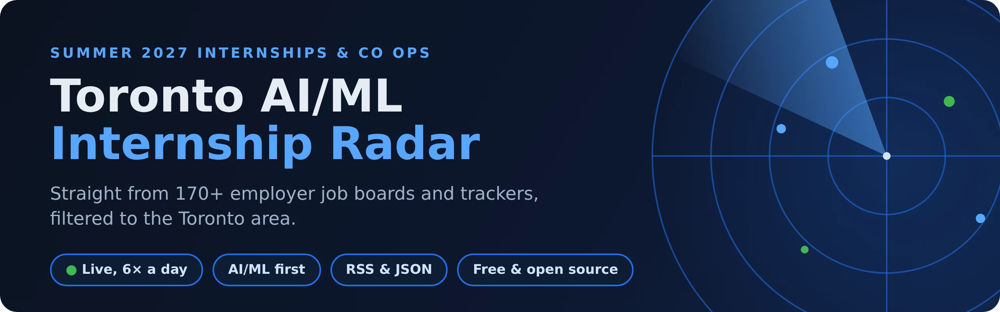

<p align="center">
  
</p>

[](https://github.com/krishi-shah/Toronto-AI-ML-internship-radar/actions/workflows/radar.yml)
[](https://github.com/krishi-shah/Toronto-AI-ML-internship-radar/stargazers)
[](https://github.com/krishi-shah/Toronto-AI-ML-internship-radar/commits/main)
[](#never-check-this-page-again)
[](LICENSE)

**Every Summer 2027 AI/ML internship and co op in and around Toronto, in one
list, refreshed six times a day.**

It reads 170+ sources directly: employer job boards (Workday, Greenhouse,
Lever, Ashby, iCIMS and more), VC portfolio boards and community trackers.
Then it keeps only roles within commuting distance of Toronto and lists each
role once. Free and open source, with no accounts and no paid APIs.

**[See the roles](#the-feed)** &nbsp;·&nbsp;
**[Get new roles automatically](#never-check-this-page-again)** &nbsp;·&nbsp;
[JSON feed](feed.json) &nbsp;·&nbsp;
[Suggest a company](../../issues/new?template=add_company.yml) &nbsp;·&nbsp;
[How it works](HOW_IT_WORKS.md)

## Why this list

- **Straight from the source.** Most roles come from the employer's own job
  board, often hours before they reach the big trackers.
- **Toronto only.** The GTA, Hamilton, Waterloo Region and Guelph, plus remote
  in Canada. Nothing from Vancouver, Montreal or the US.
- **AI/ML first.** The *Strict* list is AI, ML and data science roles,
  including software roles whose job description is mostly AI work. *Loose*
  holds other tech student roles.
- **Fresh and clean.** AI/ML roles from the last 14 days, others from the last
  7, newest first. One row per role, and a role drops out once the employer
  takes it down.
- **Summer 2027 focus.** Summer 2027 roles (including Waterloo's Spring term)
  lead the list. Roles for other terms sit in *Loose*.

## Never check this page again

- **RSS:** an RSS reader app (Feedly, Inoreader, or Slack's RSS app) shows
  new roles as they're posted, like an inbox. Copy this link and add it as a
  new feed in the app:

  ```
  https://raw.githubusercontent.com/krishi-shah/Toronto-AI-ML-internship-radar/main/feed.xml
  ```

  Opening the link in a browser shows raw code; that's normal, it's meant for
  the reader app.
- **JSON:** [`feed.json`](feed.json) has the same roles for your own scripts
  and bots.

**Found it useful?** Star the repo so other students find it, and share it
with your classmates.

---

## The feed

Everything between the markers is generated. Do not hand-edit it.

<!-- radar:listings:start -->

_Updated Thursday 26 November, 17:31 Toronto &middot; 235/237 sources healthy &middot; AI/ML last 14 days, others last 7 days, newest first._

### Strict &middot; 28 AI/ML matches &middot; last 14 days

| Role | Company | Location | Term | Posted |
|---|---|---|---|---|
| [\[I\] Robotics Engineering Intern - Capture Systems (May 2027)](https://app.dover.com/apply/peripheral/6faa193a-8c36-4416-b97b-38602292f157) | Peripheral Labs | Toronto, ON, Canada | - | **Today** |
| [Engineering AI Development Intern, Summer](https://careers.celestica.com/job/Toronto-Student-Intern%2C-Engineering-AI-Development-ON/1460691233) | Celestica | Toronto, Canada | Summer 2027 | Yesterday |
| [AI Software Development Engineer Intern](https://altera.wd1.myworkdayjobs.com/en-US/altera/job/Toronto-Ontario-Canada/AI-Software-Development-Engineer-Intern_R03487) | Altera | Toronto, Ontario, Canada | - | 2 days ago |
| [Data and Business Intelligence Analyst, Intern](https://hitachi.wd1.myworkdayjobs.com/en-US/hitachi/job/Toronto-Ontario-Canada/Data-and-Business-Intelligence-Analyst--Intern_R0151457) <br><sub>AI in description: AI agents, conversational AI, AI features</sub> | Hitachi | Toronto, Ontario, Canada | - | 2 days ago |
| [Student Intern, Engineering AI Development](https://careers.celestica.com/job/Toronto-Student-Intern%2C-Engineering-AI-Development-ON/1460691233/) | Celestica | Toronto, ON, CA | - | 2 days ago |
| [Student Intern, AI Agent Developer and Sales Enablement](https://careers.celestica.com/job/Remote-Employee-Canada-Student-Intern%2C-AI-Agent-Developer-and-Sales-Enablement-ON/1460765233/) | Celestica | Remote Employee Canada, ON, CA | - | 2 days ago |
| [Data Engineering Intern](https://jobs.ashbyhq.com/super.com/5251792e-093d-42c6-ae9e-08c656e90807) | Super.com | Canada, Toronto | - | 2 days ago |
| [Data and Business Intelligence Analyst, Intern](https://jobright.ai/jobs/info/6b05d8670a025d0ca4ff5e83?utm_campaign=1066&utm_source=git) <br><sub>AI in description: AI agents, conversational AI, AI features</sub> | Hitachi Rail | Scarborough, ON, Canada | - | 3 days ago |
| [Data Engineering Intern, Summer](https://canadiansolar.wd5.myworkdayjobs.com/CanadianSolar/job/Kitchener-ON/Data-Engineering-Intern_10001603) | Canadian Solar | Kitchener, Canada | Summer 2027 | 5 days ago |
| [Software Development - Co-op Student](https://myview.wd3.myworkdayjobs.com/en-US/paradox_careers/job/500-Lake-Shore-Blvd-W-Toronto-ON/Software-Development---Co-op-Student_R2000695571) <br><sub>AI in description: machine learning, data science, generative AI, ML engineering, AI features</sub> | Loblaw Companies | 500 Lake Shore Blvd W, Toronto, ON | - | 6 days ago |
| [Quantitative Developer (Alpha Research Team) - GAM, Summer 2027 (Co-op/Internship) - 12 months](https://bmo.wd3.myworkdayjobs.com/en-US/Privileged/job/Toronto-ON-CAN/Quantitative-Developer--Alpha-Research-Team----GAM--Summer-2027--Co-op-Internship----12-months_R260026715-2) <br><sub>AI in description: machine learning, data science, model serving</sub> | Bank of Montreal | Toronto, ON, CAN | Summer 2027 | 6 days ago |
| [Data and Artificial Intelligence Student Intern](https://recruiting.ultipro.ca/MER5001MCUL/JobBoard/6c1f133f-d0ac-48cd-a17d-bc54fe044ce3/OpportunityDetail?opportunityId=ea375757-76a7-4b9e-81d0-478ed7beb2e1) | Meridian Credit Union | Etobicoke, ON, Canada, St. Catharines, ON, Canada | - | 6 days ago |
| [Product Management Intern, Summer 2027](https://job-boards.greenhouse.io/method/jobs/8207585003) <br><sub>AI in description: data science, generative AI, AI agents</sub> | Method | Remote in USA, Santa Clara, CA, Charlotte, NC, NYC, Remote in Canada | Summer 2027 | 6 days ago |
| [Residency Internship Program - Product Management](https://job-boards.greenhouse.io/method/jobs/8207585003) <br><sub>AI in description: data science, generative AI, AI agents</sub> | Method | Charlotte, New York, Santa Clara, Remote - US, Canada | - | 6 days ago |
| [Associate AI-Enablement Developer - 8 mth Coop](https://euna.bamboohr.com/careers/822) | EUNA Solutions | Oakville, Ontario | - | found 7 days ago |
| [Physical AI &amp; Robotics Intern (2027)](https://jobs.ashbyhq.com/georgian/62da47ff-0424-4e28-bffa-cff0de8ca228) | Georgian Partners Growth | Toronto Headquarters | - | 7 days ago |
| [Data Engineering Intern](https://canadiansolar.wd5.myworkdayjobs.com/en-US/CanadianSolar/job/Kitchener-ON/Data-Engineering-Intern_10001603) | Canadian Solar | Kitchener, ON | - | 7 days ago |
| [Intern, Data Engineer Enterprise Analytics](https://saputo.wd5.myworkdayjobs.com/en-US/Saputo_External_Careers/job/Mississauga-ON/Intern--Data-Engineer-Enterprise-Analytics_JR68381) | Saputo | Mississauga, ON | - | 8 days ago |
| [FY27 Intern - GPU Compiler Development Internship - Canada (4 months)](https://qualcomm.eightfold.ai/careers/job/446722198182) <br><sub>AI in description: machine learning, deep learning, TensorFlow, scikit-learn, CUDA, AI features</sub> | Qualcomm | Markham, Ontario, Canada | - | 9 days ago |
| [Intern AI Systems (Toronto)](https://birdseyeaccount.bamboohr.com/careers/287) | Birdseye Security Solutions | Mississauga, Ontario | - | found 9 days ago |
| [Intern Computer Vision (Toronto)](https://birdseyeaccount.bamboohr.com/careers/289) | Birdseye Security Solutions | Mississauga, Ontario | - | found 9 days ago |
| [Computer Vision Intern, Summer](https://birdseyeaccount.bamboohr.com/careers/289) | Birdseye Security Solutions | Mississauga, Canada | Summer 2027 | 9 days ago |
| [AI Systems Intern, Summer](https://birdseyeaccount.bamboohr.com/careers/287) | Birdseye Security Solutions | Mississauga, Canada | Summer 2027 | 9 days ago |
| [FY27 Intern - AI/Machine Learning Internship Internship - Canada (16 months)](https://qualcomm.eightfold.ai/careers/job/446722176432) | Qualcomm | Markham, Ontario, Canada | - | 10 days ago |
| [Data Analytics &amp; AI Intern, Summer](https://www.careers.zurich.com/job/Toronto-Data-Analytics-&-AI-Intern-ON/1377641357/?ats=successfactors) | Zurich Insurance | Toronto, Canada | Summer 2027 | 10 days ago |
| [Applied Machine Learning Engineer Intern, Summer 2027](https://www.shopify.com/careers/applied-machine-learning-engineering-internships-summer-2027_1d6b9bb9-a132-4ad9-b33f-3e55d2cfc536) | Shopify | Montreal, QC, Canada, Toronto, ON, Canada, Ottawa, ON, Canada | Summer 2027 | 10 days ago |
| [Applied Machine Learning Engineer Intern, Summer](https://www.shopify.com/careers/applied-machine-learning-engineering-internships-summer-2027_1d6b9bb9-a132-4ad9-b33f-3e55d2cfc536) | Shopify | Montreal, Canada, Toronto, Canada, Ottawa, Canada | Summer 2027 | 10 days ago |
| [Intern, AI Value Creation Office](https://brookfield.wd5.myworkdayjobs.com/en-US/brookfieldprivate/job/Toronto-Ontario/Intern--AI-Value-Creation-Office_R2048790) | Brookfield | Toronto, Ontario | - | date unknown |

### Loose &middot; 53 to review

| Role | Company | Location | Term | Posted |
|---|---|---|---|---|
| [Customer Insights &amp; Analytics Intern](https://lilly.wd115.myworkdayjobs.com/en-US/cmp/job/CA-Toronto-ON/Customer-Insights---Analytics-Intern_R-116221) | Lilly | CA: Toronto ON | - | **Today** |
| [Global Markets, Summer 2027 Associate - Equity Research](https://cibc.wd3.myworkdayjobs.com/en-US/campus/job/Toronto-ON/Global-Markets-Equity-Research--Summer-2027-Associate--4-months-_2618798) | CIBC | Toronto, ON | Summer 2027 | **Today** |
| [Student Intern, Buying and Planning Data Analytics](https://jobright.ai/jobs/info/6afac7e21460f8021289d048?utm_campaign=1066&utm_source=git) | Celestica | Toronto, ON, Canada | - | Yesterday |
| [Engineering Intern - Airport Projects](https://jobs.smartrecruiters.com/AECOM2/744000163769529) | AECOM | Mississauga, ON, ca | - | Yesterday |
| [Software Intern, Winter](https://abb.wd3.myworkdayjobs.com/external_career_page/job/Dorval-Quebec-Canada/Software-Intern---Winter-2027_JR00053791) | ABB | Dorval, Canada | Winter 2027 | Yesterday |
| [Field Engineering Co-op](https://jobs.smartrecruiters.com/VeoliaEnvironnementSA/744000163749159) | Veolia | Hamilton, ON, ca | - | Yesterday |
| [Engineering Data Analytics Intern, Summer](https://careers.celestica.com/job/Toronto-Student-Intern%2C-Engineering-Data-Analytics-ON/1460684533) | Celestica | Toronto, Canada | Summer 2027 | Yesterday |
| [Embedded Solutions Intern](https://altera.wd1.myworkdayjobs.com/en-US/altera/job/Toronto-Ontario-Canada/Embedded-Solutions-Intern_R03512) | Altera | Toronto, Ontario, Canada | - | 2 days ago |
| [Student Intern, Processes and Applications, Programmer](https://jobright.ai/jobs/info/6afac7c89331e23f79cde02a?utm_campaign=1079&utm_source=git) | Celestica | Toronto, ON, Canada | - | 2 days ago |
| [Student Intern, Engineering Data Analytics](https://careers.celestica.com/job/Toronto-Student-Intern%2C-Engineering-Data-Analytics-ON/1460684533/) | Celestica | Toronto, ON, CA | - | 2 days ago |
| [Data Engineering Intern, Winter](https://jobs.ashbyhq.com/super.com/5251792e-093d-42c6-ae9e-08c656e90807) | Super | Toronto, Canada | Winter 2027 | 2 days ago |
| [Data and Business Intelligence Analyst Intern, Winter](https://hitachi.wd1.myworkdayjobs.com/hitachi/job/Toronto-Ontario-Canada/Data-and-Business-Intelligence-Analyst--Intern_R0151457) | Hitachi | Toronto, Canada | Winter 2027 | 2 days ago |
| [Embedded Solutions Intern, Summer](https://altera.wd1.myworkdayjobs.com/altera/job/Toronto-Ontario-Canada/Embedded-Solutions-Intern_R03512) | Altera | Toronto, Canada | Summer 2027 | 2 days ago |
| [Commercial Banking Rotational Internship (Office of Chief Data &amp; Analytics, Business Enablement and Strategic Initiatives), Summer 2027 - 4 Months](https://bmo.wd3.myworkdayjobs.com/en-US/External/job/Toronto-ON-CAN/Commercial-Banking-Rotational-Internship--Office-of-Chief-Data---Analytics--Business-Enablement-and-Strategic-Initiatives---Summer-2027---4-Months_R260032429-1) | BMO | Toronto, ON, CAN | Summer 2027 | 2 days ago |
| [Automation Apprenticeship/Co-Op Winter 2027/Apprentissage ou stage en automatisation – Hiver 2027](https://pg.wd5.myworkdayjobs.com/en-US/1000/job/GRTR-TORONTO-FULFILLMENT-CTR/Automation-Apprenticeship-Co-Op-Winter-2027-Apprentissage-ou-stage-en-automatisation---Hiver-2027_R000163079) | Procter &amp; Gamble | GRTR TORONTO FULFILLMENT CTR | Winter 2027 | 3 days ago |
| [Software Development Student (4 Months) - Winter 2027](https://canadiantirecorporation.wd3.myworkdayjobs.com/en-US/Enterprise_External_Careers_Site/job/Toronto-ON/Software-Development-Student--4-Months----Winter-2027_JR168222) | Canadian Tire | Toronto, ON | Winter 2027 | 3 days ago |
| [Student, Mobile Device Support Analyst (Winter 2027 - Summer 2027)](https://sunlife.wd3.myworkdayjobs.com/en-US/Campus/job/North-York-Ontario/Student--Mobile-Device-Support-Analyst--Winter-2027---Summer-2027-_JR00130144) | Sun Life | North York, Ontario | Winter 2027, Summer 2027 | 3 days ago |
| [Systems Build Intern - Waterloo University](https://job-boards.greenhouse.io/brave/jobs/8412598) | Brave | Canada | - | 3 days ago |
| [Software Development Intern - Waterloo University - Web3 Core](https://job-boards.greenhouse.io/brave/jobs/8412532) | Brave | Canada | - | 3 days ago |
| [Photonics Test Engineer](https://jobs.realventures.com/companies/real-ventures/jobs/100487237-photonics-test-engineer#content) | Real Ventures | Toronto, ON, Canada | - | 4 days ago |
| [Production Development Engineering Intern (Co-op), Winter 2027](https://jobs.realventures.com/companies/real-ventures/jobs/100488437-production-development-engineering-intern-co-op-winter-2027#content) | Real Ventures | Mississauga, ON, Canada | Winter 2027 | 4 days ago |
| [Salesforce Developer 1 Intern, Summer](https://careers.celestica.com/job/Toronto-Student-Intern%2C-Salesforce-Developer-1-ON/1458172833) | Celestica | Toronto, Canada | Summer 2027 | 6 days ago |
| [Intern, Engineering](https://saputo.wd5.myworkdayjobs.com/en-US/Saputo_External_Careers/job/Georgetown-ON/Intern--Engineering_JR68612) | Saputo | Georgetown, ON | - | 6 days ago |
| [Electronics Engineering Technologist](https://avnan.bamboohr.com/careers/125) | Avnan | Mississauga, Ontario | - | found 6 days ago |
| [Production Engineering Co-Op](https://jci.wd5.myworkdayjobs.com/en-US/JCI/job/Burlington-Massachusetts-United-States-of-America/Production-Engineering-Co-Op_EB00075404) | Johnson Controls | Burlington-Massachusetts-United States of America | - | 6 days ago |
| [Personal &amp; Business Banking Development Program (New Graduate)](https://bmo.wd3.myworkdayjobs.com/en-US/Privileged/job/Toronto-ON-CAN/Personal---Business-Banking-Development-Program--New-Graduate-_R260023509) | Bank of Montreal | Toronto, ON, CAN | - | 6 days ago |
| [Residency Internship Program - Engineering](https://job-boards.greenhouse.io/method/jobs/8208724003) | Method | Charlotte, New York, Santa Clara, Remote - US, Canada | - | 6 days ago |
| [Software Development Co-op, Winter](https://myview.wd3.myworkdayjobs.com/paradox_careers/job/500-Lake-Shore-Blvd-W-Toronto-ON/Software-Development---Co-op-Student_R2000695571) | Loblaw Companies | Toronto, Canada | Winter 2027 | 6 days ago |
| [Winter 2027 Intern – AI Program](https://careersen-mackenzieinvestments.icims.com/jobs/6446/winter-2027-intern-%e2%80%93-ai-program/job) | Mackenzie Investments | Greater Toronto Area, ON, Canada | Winter 2027 | 6 days ago |
| [\[I\] Software Engineer Intern - Infrastructure (Spring 2027)](https://app.dover.com/apply/peripheral/4f4baf30-f659-4172-881e-4497b3808ad0) | Peripheral Labs | Toronto, ON, Canada | Spring 2027 | 6 days ago |
| [\[I\] Software Engineering Intern - Viewer (Spring 2027)](https://app.dover.com/apply/peripheral/1ef74a94-ed4a-44b8-a08a-cc662066cf0c) | Peripheral Labs | Toronto, ON, Canada | Spring 2027 | 6 days ago |
| [Electronics Engineering Technologist Co-op, Winter 2027](https://avnan.bamboohr.com/careers/125/) | Avnan | Mississauga, ON, Canada | Winter 2027 | 6 days ago |
| [Engineering Student Intern, AI/ML Specialist, Winter](https://recruiting.ultipro.ca/MAC5000MCDW/JobBoard/7667adcc-47ae-477a-9183-0d8ef8bc0748/OpportunityDetail?opportunityId=b5aef546-676b-4f7a-8c20-acfa8f25069f) | MDA | Richmond, Canada | Winter 2027 | 7 days ago |
| [Software Engineer New Grad](https://jobs.ashbyhq.com/keplar/9da9bb8e-d7f1-4247-b6da-8392ebc852bd/application?embed=true) | Keplar | Toronto, ON, Canada, Waterloo, ON, Canada | - | 7 days ago |
| [Associate AI-Enablement Developer Co-op, Winter 2027](https://euna.bamboohr.com/careers/822/) | EUNA Solutions | Oakville, ON, Canada | Winter 2027 | 7 days ago |
| [Intern, Equity Research (Winter 2027)](https://pictonmahoney.bamboohr.com/careers/394) | Picton Mahoney Asset Management | Toronto, Ontario | Winter 2027 | found 7 days ago |
| [Analyst, IT Vendor Management – New Grad Opportunity](https://mckesson.wd3.myworkdayjobs.com/en-US/External_Careers/job/CAN-ON-Mississauga/Analyst--IT-Vendor-Management---New-Grad-Opportunity_JR0153988) | McKesson | CAN, ON, Mississauga | - | 7 days ago |
| [Accenture Strategy Consultant Development Program - Summer Consultant (MBA Intern) - Canada - NAELFY27](https://accenture.wd103.myworkdayjobs.com/en-US/AccentureCareers/job/Toronto-40-King-St-W-Corp/Accenture-Strategy-Consultant-Development-Program---Summer-Consultant--MBA-Intern----Canada---NAELFY27_R00353362) | Accenture | not listed | - | 7 days ago |
| [Software Developer Intern - SOTI XSight (May 2027 12 Months)](https://soti.wd3.myworkdayjobs.com/en-US/SOTI-Next-Gen/job/Mississauga-Canada--Meadowvale-Office-HQ/Software-Developer-Intern---SOTI-XSight--May-2027-12-Months-_R10718) | SOTI | Mississauga, Canada – Meadowvale Office (HQ) | - | 7 days ago |
| [FPGA Software Engineer Intern](https://altera.wd1.myworkdayjobs.com/en-US/altera/job/Toronto-Ontario-Canada/FPGA-Software-Engineer-Intern_R03445) | Altera | Toronto, Ontario, Canada | - | 7 days ago |
| [Commercial Deposits, Money Movement &amp; Digital Channels Intern/Co-op (Winter 2027)](https://td.wd3.myworkdayjobs.com/en-US/TD_Bank_Careers/job/Toronto-Ontario/Commercial-Deposits--Money-Movement---Digital-Channels-Intern-Co-op--Winter-2027-_R_1503532) | TD | Toronto, Ontario | Winter 2027 | 7 days ago |
| [Test Engineering, Co-op](https://armstrongfluidtechnology.bamboohr.com/careers/1001) | Armstrong Fluid Technology | Toronto, Ontario | - | date unknown |
| [Test &amp; Integration Technician Co-op](https://jobs.l3harris.com/job/Waterdown-Test-&-Integration-Technician-Co-op-ON-L9H-0C5/1426011400/) | L3Harris Technologies | Waterdown, ON, CA, L9H 0C5 | - | date unknown |
| [Electro-Optical Engineering Co-Op (Waterdown, CAN)](https://jobs.l3harris.com/job/Waterdown-Electro-Optical-Engineering-Co-Op-%28Waterdown%2C-CAN%29-ON-L9H-0C5/1428469000/) | L3Harris Technologies | Waterdown, ON, CA, L9H 0C5 | - | date unknown |
| [Specialty Engineering Co-Op Waterdown, CAN)](https://jobs.l3harris.com/job/Waterdown-Specialty-Engineering-Co-Op-Waterdown%2C-CAN%29-ON-L9H-0C5/1428469500/) | L3Harris Technologies | Waterdown, ON, CA, L9H 0C5 | - | date unknown |
| [Quality Systems Co-op (Waterdown, CAN)](https://jobs.l3harris.com/job/Waterdown-Quality-Systems-Co-op-%28Waterdown%2C-CAN%29-ON-L9H-0C5/1428471600/) | L3Harris Technologies | Waterdown, ON, CA, L9H 0C5 | - | date unknown |
| [Manufacturing Engineering Intern - Service Co-op](https://jobs.l3harris.com/job/Waterdown-Manufacturing-Engineering-Intern-Service-Co-op-ON-L9H-0C5/1430126700/) | L3Harris Technologies | Waterdown, ON, CA, L9H 0C5 | - | date unknown |
| [Manufacturing Engineer Co-Op (Waterdown, CAN)](https://jobs.l3harris.com/job/Waterdown-Manufacturing-Engineer-Co-Op-%28Waterdown%2C-CAN%29-ON-L9H-0C5/1430143700/) | L3Harris Technologies | Waterdown, ON, CA, L9H 0C5 | - | date unknown |
| [Project Engineering Co-Op (Waterdown, CAN)](https://jobs.l3harris.com/job/Waterdown-Project-Engineering-Co-Op-%28Waterdown%2C-CAN%29-ON-L9H-0C5/1432399900/) | L3Harris Technologies | Waterdown, ON, CA, L9H 0C5 | - | date unknown |
| [Software Engineering Co-Op (Waterdown, CAN)](https://jobs.l3harris.com/job/Waterdown-Software-Engineering-Co-Op-%28Waterdown%2C-CAN%29-ON-L9H-0C5/1432400300/) | L3Harris Technologies | Waterdown, ON, CA, L9H 0C5 | - | date unknown |
| [Systems Engineering (R&amp;A) Co-Op (Waterdown, CAN)](https://jobs.l3harris.com/job/Waterdown-Systems-Engineering-%28R&A%29-Co-Op-%28Waterdown%2C-CAN%29-ON-L9H-0C5/1435257600/) | L3Harris Technologies | Waterdown, ON, CA, L9H 0C5 | - | date unknown |
| [Manufacturing Engineering Co-op (Waterdown, CAN)](https://jobs.l3harris.com/job/Waterdown-Manufacturing-Engineering-Co-op-%28Waterdown%2C-CAN%29-ON-L9H-0C5/1441480800/) | L3Harris Technologies | Waterdown, ON, CA, L9H 0C5 | - | date unknown |
| [Intern, Data Engineer (8 Months)](https://pictonmahoney.bamboohr.com/careers/387) | Picton Mahoney Asset Management | Toronto, Ontario | - | date unknown |

<details><summary>Other fields &middot; 89 outside AI/ML</summary>

| Role | Company | Location | Term | Posted |
|---|---|---|---|---|
| [Canadian Capital Markets - Data Analyst Intern](https://tmx.wd3.myworkdayjobs.com/en-US/TMX_Careers/job/Toronto---100-Adelaide-St-W/Canadian-Capital-Markets---Data-Analyst-Intern_R-6758) | TMX Group | Toronto - 100 Adelaide St W | - | **Today** |
| [Private Client Intern](https://bmo.wd3.myworkdayjobs.com/en-US/Privileged/job/Toronto-ON-CAN/Private-Client-Intern_R260032565) | Bank of Montreal | Toronto, ON, CAN | - | **Today** |
| [Associate, Commercial Banking Associate Program – New Grad - Automotive Finance, Ontario Region](https://cibc.wd3.myworkdayjobs.com/en-US/campus/job/Toronto-ON/Associate--Commercial-Banking-Associate-Program---New-Grad---Automotive-Finance--Ontario-Region_2624757) | CIBC | Toronto, ON | - | **Today** |
| [Student, Strategy &amp; Transformation (Winter 2027)](https://sunlife.wd3.myworkdayjobs.com/en-US/Campus/job/Sun-Life-Toronto-One-York/Student--Strategy---Transformation--Winter-2027-_JR00130091) | Sun Life | Sun Life Toronto One York, Sun Life Waterloo King, Canada | Winter 2027 | **Today** |
| [Talent Acquisition Coordinator Summer Co-op](https://hdks.fa.ca2.oraclecloud.com/hcmUI/CandidateExperience/en/sites/CX_1/job/9524) | Definity Financial | Toronto, ONT, Canada | - | Yesterday |
| [Intern](https://genesys.wd1.myworkdayjobs.com/en-US/2_genesys_jobs/job/Toronto-Canada/Intern_JR113162) | Genesys | Toronto, Canada | - | Yesterday |
| [Marsh Risk Early Career Program, Property Risk Consulting Associate – Toronto](https://mmc.wd1.myworkdayjobs.com/en-US/mmc/job/Toronto---Bremner/Marsh-Risk-Early-Career-Program--Property-Risk-Consulting-Associate---Toronto_R_374230) | Marsh | Toronto - Bremner | - | Yesterday |
| [Marsh Risk Early Career Internship Program - Strategic Risk Consulting Intern, Summer 2027 – Toronto](https://mmc.wd1.myworkdayjobs.com/en-US/mmc/job/Toronto---Bremner/Marsh-Risk-Early-Career-Internship-Program---Strategic-Risk-Consulting-Intern--Summer-2027---Toronto_R_374231) | Marsh | Toronto - Bremner | Summer 2027 | Yesterday |
| [Demand Planning Intern (8 month Jan-Aug 2027)](https://sbdinc.wd1.myworkdayjobs.com/en-US/Stanley_Black_Decker_Career_Site/job/Mississauga-Ontario-Canada/Demand-Planning-Intern--8-month-Jan-Aug-2027-_REQ-1000054047) | Stanley Black &amp; Decker | Mississauga, Ontario, Canada | - | Yesterday |
| [(CAN) Pharmacy Intern](https://walmart.wd504.myworkdayjobs.com/en-US/WalmartExternal/job/CAN-SK-NORTH-BATTLEFORD-03058-WM-SUPERCENTER/XMLNAME--CAN--Pharmacy-Intern_R-2704447) | Walmart | (CAN) SK NORTH BATTLEFORD 03058 WM SUPERCENTER | - | Yesterday |
| [Junior Project Control Officer, Winter 2027 (Co-op/Internship) - 8 months](https://bmo.wd3.myworkdayjobs.com/en-US/Privileged/job/Toronto-ON-CAN/Junior-Project-Control-Officer--Winter-2027--Co-op-Internship----8-months_R260032576) | Bank of Montreal | Toronto, ON, CAN | Winter 2027 | Yesterday |
| [Junior Business Analysis, Winter 2027 (Co-op/Internship) - 8 months](https://bmo.wd3.myworkdayjobs.com/en-US/Privileged/job/Toronto-ON-CAN/Junior-Business-Analysis--Winter-2027--Co-op-Internship----8-months_R260032578) | Bank of Montreal | Toronto, ON, CAN | Winter 2027 | Yesterday |
| [TDS - 2027 Summer Analyst Program](https://td.wd3.myworkdayjobs.com/en-US/TD_Bank_Careers/job/Toronto-Ontario/TDS---2027-Summer-Analyst-Program_R_1507034) | TD | Toronto, Ontario | Summer 2027 | Yesterday |
| [Intern - Government &amp; Public Affairs (January 2027 - 18 months)](https://otppb.wd3.myworkdayjobs.com/en-US/OntarioTeachers_Careers/job/Toronto-Canada/Intern---Government---Public-Affairs--January-2027---18-months-_7363-1) | Ontario Teachers' Pension Plan | Toronto, Canada | - | Yesterday |
| [Customer Service Specialist Co-op](https://jobs.smartrecruiters.com/VeoliaEnvironnementSA/744000163759725) | Veolia | Oakville, ON, ca | - | Yesterday |
| [Health &amp; Safety Coordinator (rotational shifts) - Airport](https://jobs.smartrecruiters.com/AECOM2/744000163754709) | AECOM | Mississauga, ON, ca | - | Yesterday |
| [EI&amp;C Co-op](https://jobs.smartrecruiters.com/VeoliaEnvironnementSA/744000163741165) | Veolia | Oakville, ON, ca | - | Yesterday |
| [Accounting Co-op Associate](https://euna.bamboohr.com/careers/828) | EUNA Solutions | Oakville, Ontario | - | found 2 days ago |
| [Analyst, Supply Chain (Co-op)](https://myview.wd3.myworkdayjobs.com/en-US/paradox_careers/job/1105-Fountain-Street-North-Cambridge-ON/Analyst--Supply-Chain--Co-op-_R2000737038) | Loblaw Companies | 1105 Fountain Street North, Cambridge, ON | - | 2 days ago |
| [Personal Banker Trainee](https://td.wd3.myworkdayjobs.com/en-US/TD_Bank_Careers/job/Brampton-Ontario/Personal-Banker-Trainee_R_1524019) | TD | Brampton, Ontario | - | 2 days ago |
| [Winter Co-op 2027 - Canadian Operations Analyst (8 Months)](https://manulife.wd3.myworkdayjobs.com/en-US/MFCJH_Jobs/job/Toronto-Ontario/Winter-Co-op-2027---Canadian-Operations-Analyst--8-Months-_JR26091403) | Manulife Financial | Toronto, Ontario, Waterloo, Ontario, Halifax, Nova Scotia, Montreal, Quebec, Canada | - | 2 days ago |
| [Business Banking Relationship Manager Trainee](https://bmo.wd3.myworkdayjobs.com/en-US/External/job/Markham-ON-CAN/Business-Banking-Relationship-Manager-Trainee_R260032456) | BMO | Markham, ON, CAN | - | 2 days ago |
| [Summer Intern 2027 - Standards Assurance and Risk Monitoring](https://manulife.wd3.myworkdayjobs.com/en-US/MFCJH_Jobs/job/Toronto-Ontario/Summer-Intern-2027---Standards-Assurance-and-Risk-Monitoring_JR26071467) | Manulife Financial | Toronto, Ontario | - | 2 days ago |
| [2027 Summer Intern Opportunities - Personal &amp; Commercial Operations (PCO)](https://rbc.wd3.myworkdayjobs.com/en-US/ExternalPrivatePostingStudents/job/TORONTO-Ontario-Canada/XMLNAME-2027-Summer-Intern-Opportunities---Personal---Commercial-Operations--PCO-_R-0000185142) | Royal Bank of Canada | TORONTO, Ontario, Canada, MONTRÉAL, Quebec, Canada, MISSISSAUGA, Ontario, Canada, VANCOUVER, British Columbia, Canada, Canada | Summer 2027 | 2 days ago |
| [Student, Multimedia Production Assistant (Winter 2027)](https://sunlife.wd3.myworkdayjobs.com/en-US/Campus/job/Toronto-Ontario/Student--Multimedia-Production-Assistant--Winter-2027-_JR00129546) | Sun Life | Toronto, Ontario | Winter 2027 | 2 days ago |
| [Student, Change Management (Winter 2027)](https://sunlife.wd3.myworkdayjobs.com/en-US/Campus/job/Toronto-Ontario/Student--Change-Management_JR00129845) | Sun Life | Toronto, Ontario | Winter 2027 | 2 days ago |
| [2027 PH&amp;N Institutional, RBC GAM, Winter Institutional Analyst-Intern (8 months)](https://rbc.wd3.myworkdayjobs.com/en-US/ExternalPrivatePostingStudents/job/TORONTO-Ontario-Canada/XMLNAME-2027-PH-N-Institutional--RBC-GAM--Winter-Institutional-Analyst-Intern--8-months-_R-0000191894) | Royal Bank of Canada | TORONTO, Ontario, Canada | - | 2 days ago |
| [2027 Winter MFRM Projects - GRM, Retail Risk Modeling Intern](https://rbc.wd3.myworkdayjobs.com/en-US/ExternalPrivatePostingStudents/job/TORONTO-Ontario-Canada/XMLNAME-2027-Winter-MFRM-Projects---GRM--Retail-Risk-Modeling-Intern_R-0000193429) | Royal Bank of Canada | TORONTO, Ontario, Canada | Winter 2027 | 2 days ago |
| [Maintenance Apprentice](https://careers.cintas.com/job/Cambridge-Maintenance-Apprentice-ON-N3E-1A4/1453882400/) | Cintas | Cambridge, ON, CA, N3E 1A4 | - | 2 days ago |
| [Quality &amp; Continuous Improvement Intern](https://jobs.smartrecruiters.com/BoschGroup/744000163539719) | Bosch Home Comfort | Welland, ON, ca | - | 2 days ago |
| [Early Careers: Training &amp; Colleague Enablement Intern- 8 months](https://jobs.aon.com/jobs/106411) | Aon | Toronto, Canada, Toronto, Ontario, Canada | - | 2 days ago |
| [Junior Risk Analyst Intern](https://careers.kpmg.ca/jobs/38148?icims=1&lang=en-us) | KPMG | Toronto, ON, Canada, Victoria, BC, Canada, Saskatoon, SK, Canada, Calgary, AB, Canada, Vaughan, ON, Canada, Hamilton, ON, Canada, Edmonton, AB, Canada, St. John's, NL, Canada, Regina, SK, Canada, London, ON, Canada, Ottawa, ON, Canada, Vancouver, BC, Canada, Prince George, BC, Canada, Fredericton, NB, Canada | - | 2 days ago |
| [Client Advisor Intern](https://rbc.wd3.myworkdayjobs.com/en-US/rbcglobal1/job/CAMBRIDGE-Ontario-Canada/Client-Advisor-Intern_R-0000193381) | Royal Bank of Canada | CAMBRIDGE, Ontario, Canada | - | 2 days ago |
| [Student Warehouse Associate](https://cardinalhealth.wd1.myworkdayjobs.com/en-US/EXT/job/Canada-Vaughan-Applewood/Student-Warehouse-Associate_20191367) | Cardinal Health | Canada-Vaughan-Applewood | - | 2 days ago |
| [Summer Intern 2027 - Global Wealth &amp; Asset Management](https://manulife.wd3.myworkdayjobs.com/en-US/MFCJH_adminJobs/job/Toronto-Ontario/Summer-Intern-2027---Global-Wealth---Asset-Management_JR26081591) | Manulife Financial | Toronto, Ontario | - | 3 days ago |
| [Responsible Sourcing Co-op Student](https://myview.wd3.myworkdayjobs.com/en-US/paradox_careers/job/1-Presidents-Choice-Circle-Brampton-ON/Responsible-Sourcing-Co-op-Student_R2000699247) | Loblaw Companies | 1 Presidents Choice Circle, Brampton, ON | - | 3 days ago |
| [Corporate Finance Intern- 4 month Internship/Co-op (Summer 2027)](https://intactfc.wd3.myworkdayjobs.com/en-US/intactfc/job/Toronto-Ontario-CAN/Corporate-Finance-Intern--4-month-Internship-Co-op--Summer-2027-_R156864-1) | Intact | Toronto, Ontario, CAN | Summer 2027 | 3 days ago |
| [Personal Banking Associate Trainee](https://td.wd3.myworkdayjobs.com/en-US/TD_Bank_Careers/job/Wiarton-Ontario/Personal-Banking-Associate-Trainee_R_1523119) | TD | Wiarton, Ontario | - | 3 days ago |
| [Tool &amp; Die Maker Apprentice - Level 1](https://magna.wd3.myworkdayjobs.com/en-US/Magna/job/Brampton-Ontario-CA/Tool---Die-Maker-Apprentice---Level-1_R00271418) | Magna | Brampton, Ontario, CA | - | 3 days ago |
| [Student, Project Specialist (Winter 2027)](https://sunlife.wd3.myworkdayjobs.com/en-US/Campus/job/Toronto-Ontario/Student--Project-Specialist--Winter-2027-_JR00129682) | Sun Life | Toronto, Ontario, Waterloo, Ontario, Canada | Winter 2027 | 3 days ago |
| [First Nations, Inuit, or Métis Students Co-op and Internship Opportunities (Summer 2027)](https://cibc.wd3.myworkdayjobs.com/en-US/campus/job/Toronto-ON/First-Nations--Inuit--or-Mtis-Students-Co-op-and-Internship-Opportunities--Summer-2027-_2624355) | CIBC | Toronto, ON, New Brunswick VIRTUAL, Alberta VIRTUAL, Newfoundland VIRTUAL, British Columbia VIRTUAL, Nova Scotia VIRTUAL, Northwest Territories VIRTUAL, Nunavut VIRTUAL, Saskatchewan VIRTUAL, Manitoba VIRTUAL, Ontario VIRTUAL, Yukon VIRTUAL, Prince Edward Island VIRTUAL, Canada | Summer 2027 | 3 days ago |
| [Process and Change Management Analyst, Winter 2027 (Co-op/Internship) - 4 Months](https://bmo.wd3.myworkdayjobs.com/en-US/External/job/Toronto-ON-CAN/Process-and-Change-Management-Analyst--Winter-2027--Co-op-Internship----4-Months_R260024728-1) | BMO | Toronto, ON, CAN | Winter 2027 | 3 days ago |
| [GRM Rotational Associate](https://rbc.wd3.myworkdayjobs.com/en-US/ExternalPrivatePostingStudents/job/TORONTO-Ontario-Canada/GRM-Rotational-Associate_R-0000193252) | Royal Bank of Canada | TORONTO, Ontario, Canada | - | 3 days ago |
| [Indigenous Student/Co-Op/Intern Employment Program 2027](https://fa-evcg-saasfaprod1.fa.ocs.oraclecloud.com/hcmUI/CandidateExperience/en/sites/CX_1/job/234501) | BGIS | Canada | - | 3 days ago |
| [Intern Bachelors Field Service Technician (Missausaga/Oakville)](https://ibqbjb.fa.ocs.oraclecloud.com/hcmUI/CandidateExperience/en/sites/Honeywell/job/162993) | Honeywell | Markham, ON, Canada | - | 3 days ago |
| [Summer Intern 2027 - Canadian Operations Management (8 Months)](https://manulife.wd3.myworkdayjobs.com/en-US/MFCJH_Jobs/job/Toronto-Ontario/Summer-Intern-2027---Canadian-Operations-Management--8-Months-_JR26100180) | Manulife Financial | Toronto, Ontario | - | 4 days ago |
| [Winter Co-op 2027 - Strategy Intern](https://manulife.wd3.myworkdayjobs.com/en-US/MFCJH_Jobs/job/Toronto-Ontario/Strategy-Intern_JR26091773) | Manulife Financial | Toronto, Ontario | - | 4 days ago |
| [Intern (Bachelors) Program Control (PC Analyst)](https://icfcjb.fa.ocs.oraclecloud.com/hcmUI/CandidateExperience/en/sites/Aerospace/job/129344) | Honeywell Aerospace | Mississauga, ON, Canada | - | 4 days ago |
| [Student Intern, Supply Chain Management](https://careers.celestica.com/job/Toronto-Student-Intern%2C-Supply-Chain-Management-ON/1459786533/) | Celestica | Toronto, ON, CA | - | 4 days ago |
| [Automotive Apprentice Technician Level 2-3 (Evening Shift)](https://jobs.realventures.com/companies/real-ventures/jobs/100486100-automotive-apprentice-technician-level-2-3-evening-shift#content) | Real Ventures | Mississauga, ON, Canada | - | 4 days ago |
| [Xanadu Residency Program](https://jobs.realventures.com/companies/real-ventures/jobs/100486510-xanadu-residency-program#content) | Real Ventures | Toronto, ON, Canada | - | 4 days ago |
| [Apprentice Automotive Service Technician Level 2-3](https://jobs.realventures.com/companies/real-ventures/jobs/100488600-apprentice-automotive-service-technician-level-2-3#content) | Real Ventures | Mississauga, ON, Canada | - | 4 days ago |
| [Canadian Capital Markets Intern](https://tmx.wd3.myworkdayjobs.com/en-US/TMX_Careers/job/Toronto---100-Adelaide-St-W/Canadian-Capital-Markets-Intern_R-6736) | TMX Group | Toronto - 100 Adelaide St W | - | 6 days ago |
| [Junior Vulnerability Management Analyst Intern](https://tmx.wd3.myworkdayjobs.com/en-US/TMX_Careers/job/Toronto---100-Adelaide-St-W/Junior-Vulnerability-Management-Analyst-Intern_R-6742) | TMX Group | Toronto - 100 Adelaide St W | - | 6 days ago |
| [Intern, Maintenance Attendant](https://saputo.wd5.myworkdayjobs.com/en-US/Saputo_External_Careers/job/Tavistock-ON/Intern--Maintenance-Attendant_JR68616) | Saputo | Tavistock, ON | - | 6 days ago |
| [Intern, Continuous Improvement](https://saputo.wd5.myworkdayjobs.com/en-US/Saputo_External_Careers/job/Tavistock-ON/Intern--Continuous-Improvement_JR68647) | Saputo | Tavistock, ON | - | 6 days ago |
| [Hardware Engineering Student, Radar](https://bb.wd3.myworkdayjobs.com/en-US/Student/job/Waterloo-Ontario/Hardware-Engineering-Student--Radar_20260313) | Blackberry | Waterloo, Ontario | - | 6 days ago |
| [Tax Specialist, Winter 2027 (Co-op/Internship) - 4 months](https://bmo.wd3.myworkdayjobs.com/en-US/Privileged/job/REMOTETELETRAVAIL-ON-CAN/Tax-Specialist--Winter-2027--Co-op-Internship----4-months_R260032169) | Bank of Montreal | REMOTE/TELETRAVAIL, ON, CAN | Winter 2027 | 6 days ago |
| [Banking Advisor Intern](https://rbc.wd3.myworkdayjobs.com/en-US/rbcglobal1/job/LEAMINGTON-Ontario-Canada/Banking-Advisor-Intern_R-0000193248) | Royal Bank of Canada | LEAMINGTON, Ontario, Canada | - | 6 days ago |
| [Residency Internship Program - Program Management](https://job-boards.greenhouse.io/method/jobs/8207684003) | Method | Charlotte, New York, Santa Clara, Remote - US, Canada | - | 6 days ago |
| [Intern, Field Service Representative (8 Months) - Kitchener, Ontario](https://eaton.eightfold.ai/careers/job/687240227064) | Eaton | Kitchener, Ontario, CAN, N2C 2M3 | - | 6 days ago |
| [Automotive Apprentice Technician (Evening Shift)](https://jobs.realventures.com/companies/real-ventures/jobs/100280687-automotive-apprentice-technician-evening-shift#content) | Real Ventures | Mississauga, ON, Canada | - | 6 days ago |
| [Graphic Design Specialist - Winter 2027 Co-op/Intern](https://hdks.fa.ca2.oraclecloud.com/hcmUI/CandidateExperience/en/sites/CX_1/job/9506) | Definity Financial | Waterloo, ONT, Canada | Winter 2027 | 7 days ago |
| [Intern](https://careers.cintas.com/job/Mississauga-Intern-ON-L4Z-4G3/1452618700/) | Cintas | Mississauga, ON, CA, L4Z 4G3 | - | 7 days ago |
| [Pharmacy Intern](https://cvshealth.wd1.myworkdayjobs.com/en-US/CVS_Health_Careers/job/VT---South-Burlington/Pharmacy-Intern_R1110384) | CVS Health | VT - South Burlington | - | 7 days ago |
| [Financial Advisor Intern](https://rbc.wd3.myworkdayjobs.com/en-US/rbcglobal1/job/HAMILTON-Ontario-Canada/Financial-Advisor_R-0000193009) | Royal Bank of Canada | HAMILTON, Ontario, Canada | - | 7 days ago |
| [Electrical Engineering Co-Op (Waterdown, CAN)](https://jobs.l3harris.com/job/Waterdown-Electrical-Engineering-Co-Op-%28Waterdown%2C-CAN%29-ON-L9H-0C5/1428467500/) | L3Harris Technologies | Waterdown, ON, CA, L9H 0C5 | - | date unknown |
| [Inventory Analyst Co-Op (Waterdown, CAN)](https://jobs.l3harris.com/job/Waterdown-Inventory-Analyst-Co-Op-%28Waterdown%2C-CAN%29-ON-L9H-0C5/1428470000/) | L3Harris Technologies | Waterdown, ON, CA, L9H 0C5 | - | date unknown |
| [Logistics Co-op](https://jobs.l3harris.com/job/Waterdown-Logistics-Co-op-ON-L9H-0C5/1428471300/) | L3Harris Technologies | Waterdown, ON, CA, L9H 0C5 | - | date unknown |
| [Production Planning Co-Op (Waterdown, CAN)](https://jobs.l3harris.com/job/Waterdown-Production-Planning-Co-Op-%28Waterdown%2C-CAN%29-ON-L9H-0C5/1428472400/) | L3Harris Technologies | Waterdown, ON, CA, L9H 0C5 | - | date unknown |
| [Supply Chain Co-op (Waterdown, CAN)](https://jobs.l3harris.com/job/Waterdown-Supply-Chain-Co-op-%28Waterdown%2C-CAN%29-ON-L9H-0C5/1428472700/) | L3Harris Technologies | Waterdown, ON, CA, L9H 0C5 | - | date unknown |
| [Intern, Environmental Health &amp; Safety (Waterdown, CAN)](https://jobs.l3harris.com/job/Waterdown-Intern%2C-Environmental-Health-&-Safety-%28Waterdown%2C-CAN%29-ON-L9H-0C5/1430125700/) | L3Harris Technologies | Waterdown, ON, CA, L9H 0C5 | - | date unknown |
| [FPGA Designer Coop (Waterdown, CAN)](https://jobs.l3harris.com/job/Waterdown-FPGA-Designer-Coop-%28Waterdown%2C-CAN%29-ON-L9H-0C5/1430127300/) | L3Harris Technologies | Waterdown, ON, CA, L9H 0C5 | - | date unknown |
| [Opto-Mechanical Design Co-Op (Waterdown, CAN)](https://jobs.l3harris.com/job/Toronto-Opto-Mechanical-Design-Co-Op-%28Waterdown%2C-CAN%29-ON-M3C-2H2/1430128300/) | L3Harris Technologies | Toronto, ON, CA, M3C 2H2 | - | date unknown |
| [Sales Operations Support Co-Op (Waterdown, CAN)](https://jobs.l3harris.com/job/Waterdown-Sales-Operations-Support-Co-Op-%28Waterdown%2C-CAN%29-ON-L9H-0C5/1430141100/) | L3Harris Technologies | Waterdown, ON, CA, L9H 0C5 | - | date unknown |
| [Manufacturing Engineering - Mechanical Co-Op](https://jobs.l3harris.com/job/Waterdown-Manufacturing-Engineering-Mechanical-Co-Op-ON-L9H-0C5/1430875900/) | L3Harris Technologies | Waterdown, ON, CA, L9H 0C5 | - | date unknown |
| [Mechanical Engineering Co-Op (Waterdown, CAN)](https://jobs.l3harris.com/job/Waterdown-Mechanical-Engineering-Co-Op-%28Waterdown%2C-CAN%29-ON-L9H-0C5/1430127800/) | L3Harris Technologies | Waterdown, ON, CA, L9H 0C5 | - | date unknown |
| [Materials Co-Op (Waterdown, CAN)](https://jobs.l3harris.com/job/Waterdown-Materials-Co-Op-%28Waterdown%2C-CAN%29-ON-L9H-0C5/1435256200/) | L3Harris Technologies | Waterdown, ON, CA, L9H 0C5 | - | date unknown |
| [Operations Test Engineering, Mechanical Tooling Co-Op (Waterdown, CAN)](https://jobs.l3harris.com/job/Waterdown-Operations-Test-Engineering%2C-Mechanical-Tooling-Co-Op-%28Waterdown%2C-CAN%29-ON-L9H-0C5/1435257000/) | L3Harris Technologies | Waterdown, ON, CA, L9H 0C5 | - | date unknown |
| [Linux Administrator Co-op (Waterdown, CAN)](https://jobs.l3harris.com/job/Waterdown-Linux-Administrator-Co-op-%28Waterdown%2C-CAN%29-ON-L9H-0C5/1435258800/) | L3Harris Technologies | Waterdown, ON, CA, L9H 0C5 | - | date unknown |
| [Procurement Co-op (Waterdown, CAN)](https://jobs.l3harris.com/job/Waterdown-Procurement-Co-op-%28Waterdown%2C-CAN%29-ON-L9H-0C5/1441481400/) | L3Harris Technologies | Waterdown, ON, CA, L9H 0C5 | - | date unknown |
| [Materials - Receiving Co-op (Waterdown, CAN)](https://jobs.l3harris.com/job/Waterdown-Materials-Receiving-Co-op-%28Waterdown%2C-CAN%29-ON-L9H-0C5/1441484600/) | L3Harris Technologies | Waterdown, ON, CA, L9H 0C5 | - | date unknown |
| [Accounts Payable &amp; Tax Co-Op (Waterdown, CAN)](https://jobs.l3harris.com/job/Waterdown-Accounts-Payable-&-Tax-Co-Op-%28Waterdown%2C-CAN%29-ON-L9H-0C5/1441487900/) | L3Harris Technologies | Waterdown, ON, CA, L9H 0C5 | - | date unknown |
| [Program Management Co-op (Waterdown, Ontario) 1](https://jobs.l3harris.com/job/Waterdown-Program-Management-Co-op-%28Waterdown%2C-Ontario%29-1-ON-L9H-0C5/1441488300/) | L3Harris Technologies | Waterdown, ON, CA, L9H 0C5 | - | date unknown |
| [Operations NPI, Co-Op (Waterdown, CAN)](https://jobs.l3harris.com/job/Waterdown-Operations-NPI%2C-Co-Op-%28Waterdown%2C-CAN%29-ON-L9H-0C5/1444689200/) | L3Harris Technologies | Waterdown, ON, CA, L9H 0C5 | - | date unknown |
| [Intern, Compliance (Winter 2027)](https://pictonmahoney.bamboohr.com/careers/381) | Picton Mahoney Asset Management | Toronto, Ontario | Winter 2027 | date unknown |
| [Intern, PICTON Investment Counsel (Winter 2027)](https://pictonmahoney.bamboohr.com/careers/383) | Picton Mahoney Asset Management | Toronto, Ontario | Winter 2027 | date unknown |
| [Intern, Valuations &amp; FP&amp;A](https://brookfield.wd5.myworkdayjobs.com/en-US/brookfieldprivate/job/Toronto-Ontario/Intern_R2046748) | Brookfield | Toronto, Ontario | - | date unknown |
| [Intern](https://brookfield.wd5.myworkdayjobs.com/en-US/brookfieldprivate/job/Toronto-Ontario/Intern_R2047947) | Brookfield | Toronto, Ontario | - | date unknown |

</details>

### Sources

| Source | Postings | Status |
|---|---|---|
| Real Ventures \[getro\] | 963 | **FAIL** ConnectionError: HTTPSConnectionPool(host='jobs.realventures.com', port=443): Max retries |
| Vector Institute \[html\] | 30 | **FAIL** HTTPError: 403 Client Error: Forbidden for url: https://vectorinstitute.ai/careers/ |
| 1Password \[ashby\] | 77 | ok |
| AB InBev \[workday\] | 65 | ok |
| AECOM \[smartrecruiters\] | 248 | ok |
| AMD \[jibe\] | 78 | ok |
| Acceldata \[lever\] | 37 | ok |
| Accenture \[workday\] | 164 | ok |
| Ada \[greenhouse\] | 7 | ok |
| Affirm \[greenhouse\] | 216 | ok |
| Airbnb \[greenhouse\] | 201 | ok |
| Alexion \[workday\] | 124 | ok |
| Alstom \[successfactors\] | 130 | ok |
| Altera \[workday\] | 181 | ok |
| Amazon \[amazon\] | 157 | ok |
| American Express \[oracle\] | 171 | ok |
| Anthropic \[greenhouse\] | 634 | ok |
| Aon \[jibe\] | 39 | ok |
| Astera Labs \[greenhouse\] | 76 | ok |
| AtkinsRéalis \[workday\] | 490 | ok |
| Autodesk \[workday:uni\] | - | **empty** |
| Autodesk \[workday\] | 5 | ok |
| BDO Canada \[workday\] | 214 | ok |
| BGIS \[oracle\] | 263 | ok |
| BMO \[workday\] | 399 | ok |
| Bank of Montreal \[workday:Privileged\] | 29 | ok |
| Bank of Montreal \[workday\] | 8 | ok |
| BenchSci \[lever\] | - | **empty** |
| BiblioCommons \[workday\] | 5 | ok |
| Bird Construction \[workday\] | 153 | ok |
| Birdseye Security Solutions \[bamboohr\] | 38 | ok |
| BitGo \[greenhouse\] | 2 | ok |
| Blackberry \[workday\] | 1 | ok |
| Bree \[ashby\] | 10 | ok |
| Brookfield \[workday\] | 8 | ok |
| Burlington Stores \[workday\] | 297 | ok |
| CIBC \[workday:campus\] | 8 | ok |
| CIBC \[workday\] | 402 | ok |
| CPP Investments \[smartrecruiters\] | - | **empty** |
| CVS Health \[workday\] | 810 | ok |
| Canadian Solar \[workday\] | 34 | ok |
| Canadian Tire \[workday\] | 109 | ok |
| Canadian-Tech-Internships-2027 \[tracker\] | 215 | ok |
| Capital One \[workday\] | 554 | ok |
| Cardinal Health \[workday\] | 42 | ok |
| Celestica \[successfactors\] | 82 | ok |
| Cerebras \[ashby\] | 134 | ok |
| Ciena \[workday\] | 91 | ok |
| Cintas \[successfactors\] | 114 | ok |
| Cisco \[html\] | 48 | ok |
| Cisco \[workday\] | 480 | ok |
| Clearco \[ashby\] | 5 | ok |
| Clio \[workday\] | 140 | ok |
| Clutch Canada \[greenhouse\] | 84 | ok |
| Cohere \[ashby\] | 123 | ok |
| Coinbase \[greenhouse\] | 256 | ok |
| Confluent \[ashby\] | - | **empty** |
| Crowe \[workday\] | 159 | ok |
| D2L \[greenhouse\] | 31 | ok |
| Databricks \[greenhouse\] | 882 | ok |
| Deep Genomics \[lever\] | 1 | ok |
| Definity Financial \[oracle\] | 38 | ok |
| DoorDash \[greenhouse\] | 46 | ok |
| Dropbox \[greenhouse\] | 51 | ok |
| EUNA Solutions \[bamboohr\] | 52 | ok |
| Eaton \[eightfold\] | 37 | ok |
| Elastic \[greenhouse\] | 375 | ok |
| Entrust \[workday\] | 7 | ok |
| Equitable Bank \[lever\] | 76 | ok |
| Ericsson \[eightfold\] | 25 | ok |
| Faire \[greenhouse\] | 73 | ok |
| Float \[ashby\] | 18 | ok |
| Foresters Financial \[workday\] | 25 | ok |
| GE Healthcare \[workday\] | 531 | ok |
| GE Vernova \[workday:vernova\_externalsite\] | 552 | ok |
| GE Vernova \[workday\] | 558 | ok |
| GHD \[oracle\] | 118 | ok |
| Gastronomous Technologies \[breezy\] | 15 | ok |
| General Magic \[ashby\] | 3 | ok |
| General Motors \[workday\] | 22 | ok |
| Georgian Partners Growth \[ashby\] | 3 | ok |
| Geotab \[greenhouse\] | 53 | ok |
| GitLab \[greenhouse\] | 241 | ok |
| Golden Ventures \[consider\] | 584 | ok |
| Hitachi Energy \[workday\] | 156 | ok |
| Hitachi \[workday\] | 142 | ok |
| Honeywell Aerospace \[oracle\] | 413 | ok |
| Honeywell \[oracle\] | 443 | ok |
| Hootsuite \[greenhouse\] | 16 | ok |
| Hopper \[ashby\] | 31 | ok |
| Howden \[workday\] | 318 | ok |
| Huawei \[recruitee\] | 190 | ok |
| Human Computer Lab \[ashby\] | 14 | ok |
| Hydro One \[successfactors\] | 1 | ok |
| Ideogram \[ashby\] | 3 | ok |
| Inovia \[getro\] | 409 | ok |
| Instacart \[greenhouse\] | 97 | ok |
| Intact \[workday\] | 149 | ok |
| Intel \[workday\] | 639 | ok |
| Jobber \[ashby\] | 33 | ok |
| Jobright Data Internships \[tracker\] | 100 | ok |
| Jobright SWE Internships \[tracker\] | 100 | ok |
| Johnson &amp; Johnson \[workday\] | 578 | ok |
| Johnson Controls \[workday\] | 569 | ok |
| KPMG \[jibe\] | 122 | ok |
| Kensington \[greenhouse\] | 20 | ok |
| Kepler Communications \[lever\] | 17 | ok |
| Kinaxis \[icims\] | 99 | ok |
| Kinaxis \[jibe\] | 79 | ok |
| Kindred AI \[ashby\] | 6 | ok |
| Klue \[ashby\] | 6 | ok |
| L3Harris Technologies \[successfactors\] | 91 | ok |
| LSEG \[workday\] | 33 | ok |
| Lightmatter \[greenhouse\] | 89 | ok |
| Lilly \[workday\] | 4 | ok |
| Live Nation Entertainment \[workday\] | 24 | ok |
| Loblaw Companies \[workday\] | 650 | ok |
| Loblaw Digital \[smartrecruiters\] | 4 | ok |
| Loopio \[ashby\] | 14 | ok |
| Lyft \[greenhouse\] | 144 | ok |
| MBDA \[workday\] | 221 | ok |
| Mackenzie Investments \[icims\] | 28 | ok |
| Magna \[workday\] | 197 | ok |
| Magnet Forensics \[lever\] | 34 | ok |
| Manulife Financial \[workday:MFCJH\_adminJobs\] | 17 | ok |
| Manulife Financial \[workday\] | 183 | ok |
| Maple Leaf Sports &amp; Entertainment Partnership (MLSE) \[workday\] | 89 | ok |
| Marvell \[workday:MarvellCareers2\] | 5 | ok |
| Marvell \[workday\] | 18 | ok |
| McKesson \[workday\] | 163 | ok |
| Member Solutions \[workday\] | 21 | ok |
| Microsoft \[eightfold\] | 71 | ok |
| Miovision \[ashby\] | 13 | ok |
| MongoDB \[greenhouse\] | 421 | ok |
| Multimatic \[workday\] | 55 | ok |
| Neo Financial \[ashby\] | 59 | ok |
| New-Grad-Positions \[tracker\] | 3055 | ok |
| Nokia \[oracle\] | 25 | ok |
| Nuclear Promise X \[ashby\] | 16 | ok |
| Nvidia \[workday\] | 16 | ok |
| OLG \[workday\] | 2 | ok |
| OMERS \[workday\] | 48 | ok |
| Okta \[greenhouse\] | 360 | ok |
| Ontario Power Generation \[html\] | 15 | ok |
| Ontario Teachers' Pension Plan \[workday\] | 36 | ok |
| OpenAI \[ashby\] | 876 | ok |
| PagerDuty \[greenhouse\] | 49 | ok |
| Picton Mahoney Asset Management \[bamboohr\] | 25 | ok |
| Pinterest \[greenhouse\] | 167 | ok |
| PlayStation Waterloo Co-Op \[greenhouse\] | 3 | ok |
| Plusgrade \[workday\] | 19 | ok |
| PointClickCare \[lever\] | 80 | ok |
| Procter &amp; Gamble \[workday\] | 24 | ok |
| Prologis \[workday\] | 4 | ok |
| Qualcomm \[eightfold\] | 40 | ok |
| Quora \[ashby\] | 8 | ok |
| RSM \[workday\] | 65 | ok |
| Ramp \[ashby\] | 183 | ok |
| Red Bull \[smartrecruiters\] | 87 | ok |
| Reddit \[greenhouse\] | 149 | ok |
| Revvity \[workday\] | 2 | ok |
| Rivian and Volkswagen Group Technologies \[ashby\] | 181 | ok |
| Robinhood \[greenhouse\] | 162 | ok |
| Rocket Lab Corporation \[greenhouse\] | 553 | ok |
| Rockwell Automation \[workday:External\_Rockwell\_Automation\] | 25 | ok |
| Rockwell Automation \[workday\] | 5 | ok |
| Rodan Energy Solutions \[jazzhr\] | 17 | ok |
| Rogers \[successfactors:co-op\] | - | **empty** |
| Rogers \[successfactors\] | 105 | ok |
| Royal Bank of Canada \[workday:ExternalPrivatePostingStudents\] | 24 | ok |
| Royal Bank of Canada \[workday:rbcglobal1\] | 452 | ok |
| Royal Bank of Canada \[workday\] | 24 | ok |
| Ryan \[workday\] | 21 | ok |
| S&amp;P Global \[workday\] | 12 | ok |
| SOTI \[workday\] | 22 | ok |
| Samsara \[greenhouse\] | 298 | ok |
| Sanofi \[workday\] | 19 | ok |
| Saputo \[workday\] | 147 | ok |
| Scale AI \[greenhouse\] | 158 | ok |
| Scotiabank \[successfactors:co-op\] | 6 | ok |
| Scotiabank \[successfactors\] | 7 | ok |
| Semtech \[workday\] | 25 | ok |
| ServiceNow \[smartrecruiters\] | 26 | ok |
| Shakepay \[greenhouse\] | 7 | ok |
| Sherwin-Williams \[oracle\] | 36 | ok |
| Shopify \[html\] | 114 | ok |
| ShyftLabs \[lever\] | 26 | ok |
| Signal 1 \[bamboohr\] | 7 | ok |
| Snowflake \[ashby\] | 376 | ok |
| Solink \[ashby\] | 25 | ok |
| StackAdapt \[greenhouse\] | 73 | ok |
| Stanley Black &amp; Decker \[workday\] | 35 | ok |
| Stantec \[oracle\] | 266 | ok |
| Steel \[ashby\] | 1 | ok |
| Stripe \[greenhouse\] | 768 | ok |
| Summer2027-Internships \[tracker\] | 5078 | ok |
| Sun Life \[workday:Campus\] | 6 | ok |
| Sun Life \[workday:experienced\] | 119 | ok |
| Sun Life \[workday\] | 122 | ok |
| Super.com \[ashby\] | 13 | ok |
| TD \[workday\] | 600 | ok |
| TELUS \[successfactors:co-op\] | - | **empty** |
| TELUS \[successfactors\] | 12 | ok |
| TMX Group \[workday\] | 96 | ok |
| TTM Technologies \[workday\] | 14 | ok |
| Tailscale \[greenhouse\] | 87 | ok |
| Telus Digital \[ashby\] | 55 | ok |
| Tenstorrent \[greenhouse:tenstorrentuniversity\] | 12 | ok |
| Tenstorrent \[greenhouse\] | 154 | ok |
| Thermo Fisher Scientific \[workday\] | 613 | ok |
| Thinkific \[ashby\] | 3 | ok |
| Thomson Reuters \[workday\] | 21 | ok |
| Trimble \[workday\] | 4 | ok |
| Twilio \[greenhouse\] | 113 | ok |
| Uber \[icims\] | - | **empty** |
| Ubisoft \[smartrecruiters\] | 71 | ok |
| Uline \[workday\] | 31 | ok |
| Varian \[workday\] | 19 | ok |
| Veeda AI \[ashby\] | 10 | ok |
| Veolia \[smartrecruiters\] | 54 | ok |
| Volga Partners \[workable\] | 61 | ok |
| W.W. Grainger \[successfactors\] | 13 | ok |
| WTW \[oracle\] | 377 | ok |
| Waabi \[lever\] | 80 | ok |
| Walmart \[workday\] | 1010 | ok |
| Wattpad \[lever\] | 18 | ok |
| Wealthsimple \[ashby\] | 36 | ok |
| Workday \[workday\] | 1 | ok |
| Xanadu \[jazzhr\] | 1 | ok |
| Yotta Labs \[ashby\] | 4 | ok |
| Zurich Insurance \[successfactors\] | 30 | ok |
| ecobee \[html\] | 26 | ok |
| exacare ai \[rippling\] | 32 | ok |
| speedyapply-AI-2027 \[tracker\] | 855 | ok |
| speedyapply-SWE-2027 \[tracker\] | 850 | ok |
| vansh-Summer2027 \[tracker\] | 2526 | ok |
| zapply-Internships-2027 \[tracker\] | 600 | ok |

_Plus 337 boards discovered from Canadian postings: 337 ok, 61 promoted, 192 demoted._

<!-- radar:listings:end -->

---

## How it works

GitHub Actions runs the radar six times a day. It fetches every source, keeps
student roles in the commute area, sorts them into Strict, Loose and Other
fields, removes duplicates and rewrites the feed above, the RSS feed and the
JSON feed. A nightly job looks for new employer boards linked from tracker
postings and adds the ones with Toronto roles.

The full write up, including setup, the CLI, alert channels, adding companies
and the filtering rules, is in [HOW_IT_WORKS.md](HOW_IT_WORKS.md).

## Contributing

This radar is open to contributions, so anyone looking for the same roles can
make it better. The most useful help is often the smallest:

- **Suggest a company** it misses: open an
  [Add a company](../../issues/new?template=add_company.yml) issue.
- **Report a wrong or missing listing**, with the posting link:
  [Wrong or missing listing](../../issues/new?template=wrong_listing.yml).
- **Flag a source** showing FAIL or empty in the Sources table:
  [open an issue](../../issues/new) with its name.
- **Send a pull request**: a new company, tracker or VC job board, a
  classifier fix with its test, or a new job-board adapter.

[CONTRIBUTING.md](CONTRIBUTING.md) covers setup, running the tests and a live
check, adding companies with `--sniff` and `--probe`, and what a new adapter
needs. Please read the [Code of Conduct](CODE_OF_CONDUCT.md), and report
security issues privately as described in [SECURITY.md](SECURITY.md).

## License

[MIT](LICENSE) © 2026 Krishi Shah
